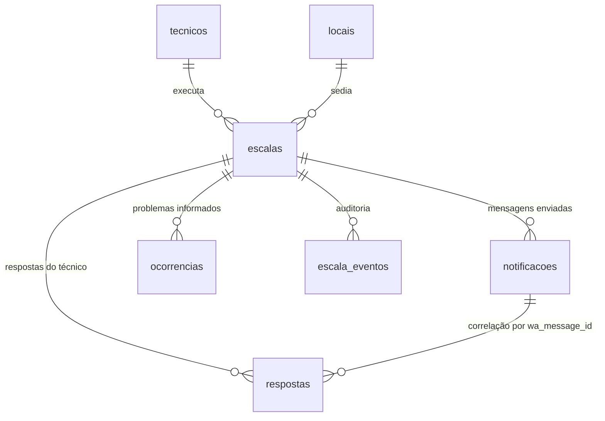

# Banco de dados

**Situação em 11/10/2026 (produção e homologação na migration 76):** 45 tabelas, 7 views, 204 funções
— 76 da API do painel (`app_*`), 12 do app do funcionário (`ponto_*`) e as internas (`fn_*`) —, 34
gatilhos e 5 tarefas agendadas (`supabase/setup/cron.sql`, conferidas pelo Checklist Sistema). Tudo
versionado em `supabase/migrations`. Quando este documento divergir do banco, o banco manda; a
seção de cada migration, abaixo, diz o que mudou e por quê.

## Mapa por domínio

| Domínio | Tabelas | Para quê |
|---|---|---|
| **Escalas** (núcleo) | `escalas`, `notificacoes`, `respostas`, `ocorrencias`, `escala_eventos`, `ligacoes`, `alertas_enviados`, `motor_estado` | Escala do técnico, envio pelo WhatsApp e pela URA, respostas, alertas aos supervisores e o motor (`fn_dispatcher_whatsapp`, a cada minuto) |
| **Cadastros** | `tecnicos`, `locais`, `empresas`, `habilidades`, `tecnico_habilidades`, `tipos_atividade`, `tipo_atividade_requisitos`, `tipo_atividade_documentos`, `feriados` | Equipe, locais, empresas do ponto, aptidão por atividade e o calendário de feriados (URA e alertas) |
| **Documentos do técnico** | `documentos`, `tipos_documento`, `tecnico_documentos` | ASO, NR, CNH com validade; retenção pela view `vw_documentos_expirados` |
| **Ponto: marcações** | `ponto_marcacoes`, `ponto_nsr`, `ponto_ajustes`, `ponto_geo`, `ponto_conversas` | Marcação imutável com NSR e cadeia de hash (Portaria 671); ajuste nunca altera a original |
| **Ponto: acesso do funcionário** | `ponto_codigos`, `ponto_sessoes`, `ponto_acessos`, `ponto_ciencias` | Login por CPF e código no WhatsApp, sessões e ciência do aviso de privacidade |
| **Ponto: justificativas** | `ponto_motivos`, `ponto_justificativas`, `ponto_abonos` | Pedido do funcionário, decisão do gestor, abono (nunca marcação inventada), afastamento e alta |
| **Ponto: cofre de documentos** | `ponto_justificativa_anexos`, `ponto_anexo_acessos`, `ponto_anexos_descartados` | O arquivo cifrado (AES-256), quem abriu e o que foi descartado (decisão 56) |
| **Ponto: registro e QR** | `ponto_documento_registros`, `ponto_documento_sequencia`, `ponto_documento_verificacoes` | Número sequencial por empresa, código do QR e quem conferiu; sobrevive ao descarte do arquivo (decisão 62). Não duplica o cofre: é outra camada sobre o mesmo documento |
| **Plataforma** | `config`, `painel_usuarios`, `painel_ve_saude_log`, `webhook_eventos`, `saude_testes`, `log_exclusoes`, `backlog_itens` | Parâmetros, usuários do painel e quem vê saúde, log do webhook (30 dias), Checklist Sistema, exclusões e o Kanban |

**Regras que valem para tudo:** RLS ligado e sem políticas; acesso só pelas funções; toda `app_*` é
`security definer` e começa por `app_exigir`; toda `ponto_*` começa por `fn_ponto_sessao`; nenhuma
função é executável pelo `service_role`; a retenção roda em `fn_limpeza_logs` (diária).

## Modelo do núcleo de escalas



## Tabelas do núcleo de escalas

| Tabela | Papel | Observações |
|---|---|---|
| `tecnicos` | Equipe de campo | `telefone_e164` único, só dígitos. `opt_in` controla envio; `is_supervisor` recebe alertas |
| `locais` | Obras e clientes | `link_maps` entra na mensagem do WhatsApp |
| `escalas` | Núcleo | Status, jornada calculada, auditoria. Índice único parcial: um técnico não tem duas escalas ativas no mesmo dia e hora — canceladas não contam |
| `notificacoes` | Uma linha por mensagem enviada | `wa_message_id` é a chave de correlação; `http_req_id` liga à resposta do pg_net |
| `respostas` | Cliques e mensagens do técnico | `wa_message_id` único garante idempotência do webhook |
| `ocorrencias` | Problemas informados | Motivo e detalhe enviados depois pelo técnico |
| `escala_eventos` | Trilha de auditoria | Quem mudou o quê e quando |
| `painel_usuarios` | Autorização | E-mail, papel (`admin`/`gestor`/`leitura`), ativo |
| `config` | Parâmetros operacionais | Muda comportamento sem deploy |
| `webhook_eventos` | Log bruto dos eventos da Evolution | A `apikey` é removida antes de gravar |
| `alertas_enviados` | Controle do alerta de prazo | Evita alerta duplicado no mesmo dia |
| `log_exclusoes` | Registro de exclusões definitivas | Não guarda nome nem telefone |
| `ligacoes` | Uma linha por ligação da URA | `call_sid` da Twilio, tecla digitada, duração e custo |
| `habilidades` | Catálogo do que o técnico sabe fazer | Não vence. NRs, CNH e ASO saíram daqui na migration 36 |
| `tipos_documento` | NR, CNH, ASO e outros documentos com validade | `palavras_chave` alimenta a classificação automática no envio em lote |
| `tecnico_documentos` | Validade de cada documento por técnico | Situação calculada em `vw_tecnico_documentos` |
| `tipo_atividade_documentos` | Documentos exigidos por tipo de atividade | Documento vencido reprova na aptidão |
| `tecnico_habilidades` | Quem sabe fazer o quê e em que nível | Sem validade: isso mora em `tecnico_documentos` |
| `tipos_atividade` | Tipos de serviço (CFTV, fibra, link...) | Ligado à escala por `escalas.tipo_atividade_id` |
| `tipo_atividade_requisitos` | Habilidades exigidas por tipo | Define quem é apto |
| `ligacoes` | Uma linha por ligação da URA | `call_sid` da Twilio, tecla digitada, duração e custo |
| `documentos` | Arquivos de NR, CNH e ASO | Sem as colunas `origem` e `url`: a migration 50 (decisão 42) removeu o vínculo por link. Todo documento vive no bucket privado |
| `empresas` | Empregadoras e clientes (CNPJ) | Base do Módulo Registro de Ponto (migration 53) |
| `backlog_itens` | Backlog do produto exibido na aba Roadmap | Grupos backlog, entrega e dívida; coluna do Kanban e posição |

### Status da escala

`rascunho` → `agendada` → `notificada` → `confirmada` | `recusada` → `em_execucao` → `concluida`.
`cancelada` e `reagendada` a qualquer momento. Só `agendada` e `notificada` entram no motor.

### Status do envio

`enfileirada` → `enviada` → `entregue` → `lida`, ou `falha`. O webhook nunca rebaixa o status.

## Views

| View | Para que serve |
|---|---|
| `vw_escalas_painel` | Tabela principal, com semáforo, jornada e `pode_remover` |
| `vw_acoes_pendentes` | O motor: o que fazer agora e com qual diagnóstico. Compara a hora local da escala com a hora local atual (migration 39) |
| `vw_linha_do_tempo` | Auditoria + eventos do WhatsApp em ordem |
| `vw_ligacoes_pendentes` | Quem deve receber ligação agora: já recebeu WhatsApp N vezes, não respondeu, dentro da janela |
| `vw_documentos_expirados` | Documentos que passaram dos 5 anos após o desligamento do técnico |
| `vw_tecnico_habilidades` | Habilidades por técnico, com o nível |
| `vw_tecnico_documentos` | Documentos por técnico com situação: válido, vence em breve, vencido, sem data |

## Funções por família

**API do painel (`app_*`)** — únicas expostas ao navegador. Identificam o usuário por
`auth.jwt()`, conferem o papel e executam: `app_meu_acesso`, `app_escalas`, `app_resumo`,
`app_linha_do_tempo`, `app_tecnicos`, `app_locais`, `app_pendencias`,
`app_simular_jornada`, `app_criar_escalas`, `app_mudar_status`, `app_remover_escala`,
`app_reenviar_escala`, `app_salvar_tecnico`, `app_excluir_tecnico`, `app_salvar_local`,
`app_usuarios`, `app_salvar_usuario`, `app_habilidades`, `app_salvar_habilidade`,
`app_tecnico_habilidades`, `app_remover_tecnico_habilidade`,
`app_tipos_atividade`, `app_salvar_tipo_atividade`, `app_aptidao`, `app_painel_locais`,
`app_definir_habilidades`, `app_excluir_habilidade`, `app_habilidades_por_tecnico`,
`app_ligacoes`, `app_ligar_escala`, `app_documentos`, `app_registrar_documento`,
`app_excluir_documento`, `app_backlog`, `app_salvar_backlog_item`,
`app_mover_backlog_item`, `app_pode_gerir_documentos` (usada pelas políticas do bucket `documentos`).

> **Permissão por laço:** toda migration termina revogando `execute` de tudo no schema e
> concedendo de novo a **todas** as funções com prefixo `app_`. Lista manual já derrubou o painel
> uma vez (migration 26, corrigida na 27).

**Regra de negócio (`fn_*`)** — `fn_criar_escala`, `fn_criar_escalas_lote`, `fn_mudar_status`,
`fn_remover_escala`, `fn_excluir_tecnico`, `fn_salvar_usuario_painel`, `fn_exigir_papel`,
`fn_papel`, `fn_calcular_jornada`, `fn_pendencias_escala`.

**Mensageria** — `fn_dispatcher_whatsapp` (o motor, fases 1 a 6: confere respostas da Evolution, envia, aciona supervisores, alerta de prazo, documentos vencidos e ligações; desde a migration 41 uma falha numa escala fica registrada nela, com `erro_codigo = 'interno'`, sem travar as outras), `fn_payload_escala`, `fn_corpo_escala`,
`fn_titulo_escala`, `fn_msg_escala`, `fn_msg_supervisor`, `fn_evo_post`, `fn_evo_get`,
`fn_wa_texto`, `fn_avisar_supervisores`, `fn_alerta_prazo_escala`.

**Voz (URA)** — `fn_preparar_ligacao`, `fn_registrar_call_sid`, `fn_voz_twiml`, `fn_voz_resposta`,
`fn_voz_status`, `fn_disparar_ligacoes`, `fn_xml_escape`.

**Regras de escala** — `fn_validar_inicio` (nunca no passado), `fn_marcar_escala_teste`,
`fn_calcular_jornada`, `fn_aplicar_jornada`, `fn_aptidao`, `fn_nivel_valor`.

**Webhook** — `fn_webhook_evolution` (porta de entrada, confere o token), `fn_wh_status`
(entrega e leitura), `fn_wh_mensagem` (botões, 1/2, texto livre), `fn_tel_canonico`.

**Vigia do motor** — `fn_vigiar_motor` (agendada a cada 5 minutos em `setup/cron.sql`) lê
`motor_estado.ultima_execucao_ok`, gravada pelo motor ao fim de cada execução concluída, e avisa os
supervisores quando passam `motor_alerta_min` minutos sem execução (uma vez por ocorrência, dentro
da janela de envio) e quando normaliza. `app_estado_motor` alimenta o quadro da aba Operação
(migration 44).

**Infra** — `fn_config`, `fn_config_int`, `fn_segredo` (lê do Vault), `fn_fmt_duracao`,
`fn_http_resposta`, `fn_limpeza_logs` (retenção de logs, agendada em `setup/cron.sql`).

> **Hora da escala:** `data_servico` e `hora_inicio` são hora local, sem fuso. Nunca comparar
> `data_servico + hora_inicio` com `now()`, que é UTC no servidor. Comparar com
> `now() at time zone fn_config('fuso')`.

> **Pendência de limpeza:** `fn_teste_wa_texto`, `fn_teste_wa_botoes` e `fn_teste_wa_resposta`
> são da bancada de teste da migration 07 e podem ser removidas.

> **Backlog do Roadmap:** `backlog_itens.numero` é obrigatório, único e atribuído pelo gatilho
> `trg_backlog_numero` (`fn_numerar_backlog`), em sequência única para todos os grupos, desde a
> migration 43. Depois de atribuído, não muda. O painel exibe com três dígitos (001).

### Migrations 45 e 46 (27/09)

| Peça | O que faz |
|---|---|
| `fn_concluir_escalas()` | Fase 7 do motor: confirmada/em execução vira concluída 5 min depois do término previsto |
| `escalas_horario_ativo_unico` | Índice único parcial agora ignora `cancelada` e `recusada` (decisão 31) |
| `fn_pendencias_escala` | Técnico só com escala recusada conta como "sem escala" |
| `fn_dispatcher_whatsapp` | Trava `pg_try_advisory_xact_lock` (uma execução por vez), `lock_timeout` de 20 s, fase 7 e sinal ao monitor externo |
| `fn_evolution_falhando()` | Verdadeiro com 2+ falhas e nenhum envio com sucesso nos últimos 15 min; o sinal vai como `/fail` |
| `fn_avisar_tecnico(texto)` | WhatsApp para `alerta_tecnico_telefones` (sem repetir quem já é supervisor) |
| `fn_vigiar_motor` | Também avisa os telefones técnicos e, uma vez por dia na janela, o banco acima de `banco_alerta_mb` |
| `fn_limpeza_logs` | Também apaga `payload_envio` com mais de 90 dias |
| `fn_validar_config` / `trg_config_validar` | Validação dos parâmetros |
| Índices | `respostas(notificacao_id)`, `ocorrencias(escala_id)`, `ligacoes(tecnico_id)`, `escalas(local_id)`, `tecnico_documentos(documento_id)`; removido o duplicado `idx_notif_wa` |
| Removidas | `fn_teste_wa_botoes`, `fn_teste_wa_resposta`, `fn_teste_wa_texto` (bancada de teste) |

### Migration 47 (27/09): backlog 064 e 065

| Peça | O que faz |
|---|---|
| `fn_wh_mensagem` | Depois do "2", pede o motivo (1 Saúde, 2 Transporte, 3 Conflito de agenda, 4 Falta de material, 5 Outro) e grava em `ocorrencias.motivo`. Só pergunta se o técnico não tem outra escala aguardando resposta. Texto livre vira detalhe e, sem motivo, "outro" |
| `fn_motivo_rotulo(texto)` | Nome do motivo para mensagens e painel |
| `app_indicadores_resposta(dias)` | Recusas por motivo e mediana do tempo entre o primeiro envio e a resposta (aba Operação) |
| `app_escala_edicao(id)` / `app_editar_escala(p)` | Editar data, hora, local e tarefa. Mudou data, hora ou local de escala enviada: volta a aguardar resposta e reenvia. Só tarefa: avisa o técnico |
| `fn_edicao_permitida` (migration 48) | Intervalo mínimo de 2 minutos entre edições da mesma escala; escala de teste não avisa o técnico. Desde a migration 49 o motivo de saúde não existe (decisão 40) |
| `app_substituir_tecnico(escala, tecnico)` | Escala recusada gera outra igual para o técnico escolhido; eventos `substituida`/`substitui` ligam as duas |

### Migration 20260928235626 (28/09): trava de envio por ambiente (decisão 44)

`config.ambiente` (`producao` | `homologacao`) e `config.telefones_homologacao`. `fn_pode_enviar(telefone)`
libera tudo em produção; em homologação, só técnico com `perfil_teste` ou número liberado.
`fn_evo_post` (toda saída de WhatsApp) e `fn_preparar_ligacao` (URA) consultam a trava; `app_config`
devolve `ambiente`.

### Migration 51 (29/09): Administração do Sistema > Checklist

| Objeto | O que faz |
|---|---|
| `saude_testes` | Registro das consultas ao vivo (`alvo` = `evolution` ou `status_*`, `req_id` do pg_net, erro, quem testou em `criado_por` = e-mail do admin). RLS ligado, sem políticas. Guarda as 100 linhas mais recentes (20 testes). |
| `app_checklist_testar()` | Só admin. Enfileira pelo pg_net o `connectionState` da Evolution e as quatro páginas públicas de status (Supabase, Twilio, GitHub, Vercel). Dentro de 10 s do último teste, não repete (`recente: true`). |
| `app_checklist_saude()` | Só admin. Devolve itens `{grupo, item, estado ok/atencao/falha/info, detalhe}`: banco (tamanho, última migration), motor, cron, pg_net, configuração e conexão da Evolution, webhook, envios, escalas vencidas sem envio, notificações e webhook com erro, credenciais e ligações da Twilio. Só contagens, datas e nomes de segredos (nunca valores); da resposta da Evolution sai só o código HTTP e o `state`. |

Todas as consultas externas saem do banco: o navegador do admin só fala com o Supabase. Das páginas de
status lê-se só `status.indicator` e `status.description`. O painel acrescenta, sem rede, a versão
publicada e o link do GitHub Actions.

### Migration 52 (30/09): índices das chaves estrangeiras

Cinco índices pedidos pelo linter do Supabase (`unindexed_foreign_keys`): `documentos`,
`tecnico_documentos` e `tipo_atividade_documentos` em `tipo_documento_id`; `tecnico_habilidades` e
`tipo_atividade_requisitos` em `habilidade_id`. Só estrutura.

### Migration 53 (06/10): Módulo Registro de Ponto — cadastros-base (backlog 080, decisão 48)

- **`empresas`** (nova, RLS sem políticas): CNPJ único com dígito verificador (`fn_cnpj_valido`),
  razão social, cidade/UF, fuso (`America/Bahia`), `empregadora` (o ponto dos funcionários sai no
  CNPJ dela). Funções `app_empresas` (todos os papéis) e `app_salvar_empresa` (admin, gestor).
- **`tecnicos`**: `cpf` (dígito verificador por `fn_cpf_valido`, único), `matricula` (única por
  empresa), `admissao`, `empresa_id`. **Minimização (revisão do `seguranca`):** a lista de
  `app_tecnicos` nunca traz o CPF inteiro — admin e gestor recebem `***.982.247-**` (padrão gov.br,
  sem os dígitos verificadores), leitura recebe nulo; o CPF inteiro só sai por `app_tecnico_cpf`
  (admin, gestor), chamada ao abrir a ficha. `app_salvar_tecnico` ignora CPF mascarado e só altera um
  campo novo quando ele vem no pedido. Corrige a data de desligamento, que a tela mandava e a função
  ignorava. `app_salvar_local` passa a recusar link do Maps que não comece com `http(s)://`.
- **`locais`**: `latitude`, `longitude` (as duas ou nenhuma), `raio_m` (20 a 5.000, padrão 200) e
  `cliente_empresa_id`. A área é usada no ponto para sinalizar marcação fora do local.
- Índices nas três chaves estrangeiras novas.

### Migration 54 (06/10): Módulo Registro de Ponto — marcações (backlog 081, decisão 48)

- **`ponto_marcacoes`** (RLS sem políticas): **só inclusão** — gatilhos recusam update, delete e
  truncate (`fn_ponto_imutavel`). NSR sequencial por empresa sem lacuna (a linha de `ponto_nsr` fica
  travada na transação), hora do servidor (`momento`), CPF do momento, tipo (entrada, saída e volta
  do almoço, saída, início e fim de hora extra), canal (app, WhatsApp, URA), localização obrigatória
  fora da URA, local de referência (o da escala de hoje; sem escala, o local com área mais perto),
  distância e `dentro_area` (tolerância: precisão do aparelho, até 100 m). Fora da área é sinalizado,
  nunca bloqueado. **Hash encadeado** (`fn_ponto_hash`, SHA-256 de todos os campos + hash anterior).
- **Porta única garantida pelo banco** (revisão do `seguranca`): gatilho `before insert` recusa
  marcação que não continue a cadeia (NSR seguinte, hash anterior, hash conferido, hora de agora);
  `ponto_nsr` só avança de um em um; `anon`, `authenticated` e **`service_role`** sem nenhum acesso
  direto às três tabelas. `origem` guarda só `msg_id`, `call_sid` e `app_versao` (até 2 KB) — nunca
  o conteúdo da mensagem, porque a tabela não admite descarte antes do prazo.
- **`ponto_ajustes`**: incluir ou desconsiderar, com motivo (mínimo 10 caracteres) e autor; também só
  inclusão. A marcação original nunca muda.
- **`fn_ponto_registrar`** (interna, sem acesso pelo painel): a porta única dos canais; devolve o
  comprovante (NSR, empresa, CNPJ, nome, CPF, data, hora no fuso da empresa, tipo, local, código de
  autenticação).
- **`app_ponto_marcacoes`** (todos os papéis; leitura sem coordenadas, até 62 dias) e
  **`app_ponto_verificar`** (admin: recalcula a cadeia e aponta lacuna ou hash adulterado).
- Gatilho em `tecnicos`: técnico com marcação **não pode ser excluído** (guarda de 5 anos).
- Nenhuma rotina de limpeza toca nestas tabelas. Descarte depois de 5 anos só por migration própria,
  que desliga o gatilho de forma registrada.

### Migration 55 (07/10): Módulo Registro de Ponto — login do funcionário (backlog 082, decisão 49)

- **`ponto_codigos`** (código de 6 dígitos só como hash; origem WhatsApp ou gestor; tentativas),
  **`ponto_sessoes`** (hash do token, 12 h, sessão única, `login_origem`), **`ponto_ciencias`**
  (ciência do aviso de privacidade por versão) e **`ponto_acessos`** (pedidos e tentativas, com IP — `cf-connecting-ip` ou o último
  endereço do `x-forwarded-for`, nunca o primeiro, que quem chama controla: base dos limites). RLS sem políticas; nenhum papel com acesso direto. Guarda (LGPD, em
  `fn_limpeza_logs`): códigos 24 h, sessões 90 dias, acessos 30 dias.
- Limites contra força bruta e disparo em massa: ver decisão 49. Com teto total estourado, só o
  código do gestor entra, e os supervisores recebem aviso pelo WhatsApp (uma vez por hora,
  `fn_ponto_alerta_teto`). O gestor que gerou o código fica na sessão e na marcação (`origem.gestor`, e-mail do gestor:
  dado pessoal guardado 5 anos dentro do hash, com base legal na apuração de fraude no ponto). Erro de
  login gasta só as tentativas do código de WhatsApp; o código do gestor passa por cima do bloqueio
  por funcionário e continua sob os limites por IP e total. Parâmetros novos em `config`:
  `ponto_max_codigos_hora` (60) e `ponto_max_erros_hora` (300).
- API do funcionário (`anon`): `ponto_pedir_codigo`, `ponto_entrar`, `ponto_sair`, `ponto_eu`,
  `ponto_registrar_ciencia`, `ponto_bater` (chama `fn_ponto_registrar` com o funcionário da sessão) e
  `ponto_minhas_marcacoes`. Contingência no painel: `app_ponto_gerar_codigo` (admin, gestor; 15 min).

### Migration 94 (13/10): Escala / Carga Horária e Times, etapa 1 (decisão 88)

- Tabelas: `times` (empresa, nome único na empresa, ativo); `tecnicos.time_id`, resolvido pelo gatilho
  `trg_tecnico_time` a partir de `equipe` e `empresa_id` (acha ou cria o time); `cargas_horarias` (empresa
  empregadora, tipo `semanal`/`revezamento`/`12x36`, minutos de segunda a domingo ou plantão, intervalo, entrada
  opcional, média semanal, riscos aceitos; não muda, só `ativo`, gatilho `fn_carga_imutavel`); `carga_aceites`
  (texto exato do termo, instrumento coletivo, nome, e-mail, papel, hora e SHA-256; só inclusão);
  `carga_atribuicoes` (alvo empresa, time ou funcionário, início e fim, cancelamento só antes de começar).
- `fn_carga_validar(p)`: `{semanal_min, bloqueios, riscos, avisos}` pela CLT (parecer do `juridico`).
  `fn_carga_atribuicao(tecnico, data)`: a atribuição que vale (funcionário > time > empresa).
  `fn_carga_minutos_dia(tecnico, data)`: minutos contratuais do dia; sem escala, `jornada_min` de segunda a sexta,
  `ponto_jornada_sabado_min` no sábado e 0 no domingo; 12x36 com plantão no primeiro dia da vigência e dia sim, dia não.
- API: `app_cargas_modelos`, `app_carga_validar`, `app_salvar_carga(p, p_aceite)` (bloqueio não salva; risco só com
  `{aceito: true}`), `app_carga_ativar`, `app_cargas`, `app_atribuir_carga`, `app_cancelar_atribuicao`,
  `app_carga_atribuicoes`, `app_cargas_funcionarios`, `app_times`, `app_salvar_time`, `app_time_definir_membros`.
  Escrita: admin e gestor; leitura também para o papel leitura.
- `fn_carga_termo`: o texto do termo de aceite; `app_carga_validar(p, p_instrumento)` devolve-o em `termo` e
  `app_salvar_carga` grava esse mesmo texto mais a hora. O aceite traz os códigos dos riscos que o painel mostrou
  (`p_aceite.riscos`); se não coincidem com os atuais, recusa. Papel leitura: `criado_por`, `aceite_nome`,
  `aceite_texto` e `aceite_sha256` vêm nulos.
- Gatilho `fn_carga_imutavel` nas três tabelas: escala só muda `ativo`; aceite não muda; atribuição só muda o fim
  (de hoje em diante) e o cancelamento; nada é apagado.
- Carga inicial: escala "Jornada padrão" (`jornada_min` de segunda a sexta e `ponto_jornada_sabado_min` no sábado;
  44h 6x1 por padrão) para cada empregadora ativa, atribuída à empresa a partir da data da aplicação.
  `fn_payload_escala` recriada com o rodapé "Trilha".

### Migration 93 (13/10): "Escala" vira "Programação" nos textos (decisão 87)

- Só textos entre aspas, em 21 funções (mensagens do WhatsApp e da URA, avisos ao supervisor, mensagens de
  erro): `fn_titulo_escala` ("PROGRAMAÇÃO — dd/mm"), `fn_payload_escala`, `fn_msg_supervisor`,
  `fn_wh_mensagem`, `fn_voz_twiml`, `fn_voz_resposta`, `fn_alerta_prazo_escala`, `fn_vigiar_motor`,
  `fn_remover_escala`, `app_editar_escala`, `app_reenviar_escala`, `app_substituir_tecnico`, entre outras.
  Nomes de tabelas, colunas e funções não mudam.

### Migration 92 (13/10): cofre das folhas assinadas (decisão 86)

- `painel_usuarios.rh_folhas` e `fn_rh_folhas(email)`: permissão "cofre de folhas assinadas" (admin ou gestor,
  ativo). `app_definir_rh_folhas` e `app_rh_folhas_historico` (admin), histórico em `painel_rh_folhas_log` (só
  inclusão). `app_meu_acesso` devolve `rh_folhas`.
- `app_ponto_espelho_ver` (recriada): folha assinada só com `rh_folhas`, e a abertura fica em
  `ponto_espelho_acessos` (só inclusão, RLS sem políticas).
- `app_ponto_cofre_folhas(p_competencia, p_tecnico)` e `app_ponto_espelho_prova(p_id)` (só `rh_folhas`): lista
  das folhas assinadas e a prova para perícia (conteúdo exato, hashes, assinatura, HMAC conferido). Teste T39.

### Migration 91 (13/10): HMAC na assinatura e folga compensatória (decisão 84)

- `fn_ponto_assinatura_hash` passa a HMAC-SHA256 com a chave `ESPELHO_ASSINATURA` do Vault (criada pela
  migration, no próprio banco). `ponto_espelhos.assinatura_chave` guarda a impressão da chave que assinou
  (`fn_ponto_assinatura_chave`, 8 hexadecimais); `ponto_assinar_espelho` grava, o gatilho de imutabilidade
  protege, e `ponto_verificar_espelho` devolve `assinatura_chave_indisponivel` em vez de "não confere" quando
  a chave do banco é outra.
- `ponto_abonos.folga_de`: o domingo ou feriado trabalhado que o dia de folga compensa.
  `app_ponto_folga_compensatoria(p_tecnico, p_folga, p_trabalhado)` (admin, gestor) lança a folga: dia
  inteiro abonado, até 6 dias do trabalho, uma por domingo ou feriado, só com trabalho no ponto naquele dia;
  recusa sábado sem expediente, dia fora do vínculo, dia com trabalho, folga passada há mais de 7 dias e mês
  com espelho emitido; avisa o funcionário pelo WhatsApp. Motivo `folga_compensatoria` no catálogo, inativo.
- `fn_ponto_espelho_conteudo`: domingo ou feriado compensado (folga já acontecida, sem trabalho) sai como trabalho comum (HE 50% acima de 8 h, sem
  100%); por dia, `folga_de` e `compensado_em`; no informativo, `folgas_compensatorias` e
  `domingos_feriados_compensados`. Teste T38.

### Migration 90 (13/10): resumo de pagamento no espelho, em horas (decisão 83)

- `fn_ponto_noturno_dia(tecnico, data, fuso)`: minutos de relógio trabalhados entre 22 h e 5 h no dia, pelos
  pares de marcações efetivas.
- `fn_ponto_espelho_conteudo` recriada: todos os dias do vínculo no mês (a partir da primeira marcação), com
  `previsto_min`, `he50_min`, `he100_min`, `noturno_min`, `debito_min` e `feriado` por dia (o motivo de saúde
  não entra: o atestado só muda o cálculo); bloco
  `resumo` com `a_pagar` (HE 50%, HE 100%, noturnas reduzidas, intervalo não concedido), `a_descontar`
  (débito, dias sem registro, semanas com falta) e `informativo` (previstas, trabalhadas, abonadas com
  justificativa e pela empresa, dias abonados com justificativa, feriados e alertas); `avisos` ao funcionário. Mês sem
  nenhum registro continua sem espelho. Teste T37.

### Migration 89 (13/10): espelho mensal, parte B — envio e assinatura (decisão 82)

- `app_ponto_enviar_espelhos(p_competencia, p_espelho)` (admin, gestor): manda pelo WhatsApp o link
  `app_url/ponto?espelho=id` dos espelhos vigentes não assinados e não enviados, ou reenvia um (`p_espelho`);
  pula desligado, sem `opt_in` e barrado por `fn_pode_enviar`; `enviado_em` guarda o primeiro envio. Config
  nova `app_url`.
- `app_ponto_espelho_ver(p_id)` (admin, gestor): conteúdo e assinatura para ver e imprimir.
- `ponto_meus_espelhos(p_token)`, `ponto_meu_espelho(p_token, p_id)` e
  `ponto_assinar_espelho(p_token, p_id, p_sha256, p_assinatura, p_ciente)`: só o próprio funcionário; assina
  só a versão vigente cujo hash ele viu; PNG em data URL até 300 KB; grava IP e aparelho.
- `fn_ponto_assinatura_hash`: SHA-256 de hash do espelho, imagem, hora (UTC), IP e aparelho (como texto);
  `ponto_verificar_espelho` passa a conferir a assinatura por ele. Teste T36.

### Migration 88 (13/10): espelho de ponto mensal com registro e QR (decisão 82, parte A)

- Tabela `ponto_espelhos`: cópia congelada do espelho de um funcionário num mês (`conteudo` jsonb, Portaria
  671 Art. 84), `sha256`, `registro` por empresa sem lacuna (`ponto_espelho_sequencia`), `codigo` de
  verificação (80 bits, `fn_ponto_codigo_verificacao`), versão e substituição; colunas de envio e assinatura
  para a parte B. Conteúdo imutável; envio, substituição e assinatura gravados uma vez só
  (`fn_ponto_espelho_imutavel`); sem delete nem truncate. RLS sem políticas.
- `fn_ponto_espelho_conteudo(tecnico, mes)`: empregador, trabalhador (nome, CPF, admissão, função), jornada
  contratual, dias (`fn_ponto_jornada_dia`), marcações tratadas (ajustes com motivo, sem o e-mail de quem
  tratou) e totais.
- `app_ponto_emitir_espelhos(p_competencia, p_tecnico)` (admin, gestor): só mês encerrado; não reemite
  assinado; reemissão igual não cria versão. `app_ponto_espelhos(p_competencia)` (admin, gestor, leitura).
- `ponto_verificar_espelho(p_codigo)`: conferência pública do QR (anon, sem sessão — exceção no CI), devolve
  só registro, empresa, CNPJ, mês, emissão, integridade e assinatura; nenhum nome, CPF ou horário. Teste T35.

### Migration 87 (13/10): AFD do REP-P, versão de conferência (backlog 085, decisão 81)

- `app_ponto_afd(p_empresa, p_de, p_ate)` (só admin): texto do AFD no leiaute do Anexo V da Portaria 671 —
  cabeçalho (tipo 1) com CRC-16/KERMIT, marcações do REP-P (tipo 7) com SHA-256 dos campos 1 a 7 mais o hash
  do registro anterior (encadeado desde a primeira marcação da empresa, mesmo fora do período), trailer (tipo
  9); ISO 8859-1, CR LF. Devolve nome, conteúdo, quantidade, sha256 e o aviso de versão de conferência.
- Auxiliares `fn_afd_crc16`, `fn_afd_a` (alfanumérico com espaço, só ISO 8859-1), `fn_afd_n` (numérico com
  zeros), `fn_afd_dh` (data e hora com fuso, segundos 00).
- Tabela `ponto_afd_geracoes` (quem, empresa, período, quantidade, sha256; sem CPF): só inclusão. Config
  `rep_p_inpi` e `rep_p_desenvolvedor_cnpj` (vazias) e `afd_leiaute_conferido` (`false`: nome com
  `_CONFERENCIA`). Teste T34.

### Migration 86 (13/10): dossiê de conformidade por local (backlog 100, decisão 79)

- Tabela `dossie_geracoes` (email, local, data, técnicos, quando): RLS ligado sem políticas, só inclusão
  (`fn_ponto_imutavel` em update, delete e truncate).
- `app_dossie_local(p_local, p_data)` (admin, gestor, leitura): técnicos escalados no local e na data (fora
  teste, cancelada, recusada e rascunho), cada um com os documentos que a atividade exige e a situação na
  data do serviço (`valido`, `vencendo` até `certificacao_aviso_dias`, `vencido`, `sem_data`,
  `nao_cadastrado`) e `apto` (escala sem tipo de atividade sai `sem_atividade` e nunca apta). Só a situação, sem arquivo, CPF ou telefone. Registra a geração. Teste T32.

### Migration 85 (13/10): painel gerencial de aderência (backlog 099, decisão 78)

- `app_painel_gerencial(p_de, p_ate)` (admin, gestor, leitura; até 62 dias): escala (enviadas, resolvidas
  pelo WhatsApp — resposta com `wa_message_id` —, pela URA, sem resposta, ligações e atendidas, mediana) e
  ponto (funcionários com CPF e empresa, fora os de teste, entre a admissão e o desligamento; dia a dia até
  ontem por `fn_ponto_jornada_dia`: marcações, ajustes, abonos, hora extra acima da jornada de cada dia,
  saldo de horas, alertas por tipo, semanas acima de 44 h e abaixo do esperado). Só agregados, sem nome.
- Config nova: `ponto_jornada_sabado_min` (240) e `ponto_sabado_sem_expediente_abona` (`true`). Teste T31.

### Migration 84 (13/10): ponto não captura a explicação de uma recusa

- `fn_wh_mensagem`: ao registrar a recusa (problema), fecha a conversa do ponto aberta do técnico.
- `fn_ponto_wh`: com recusa aberta esperando o motivo (até 2 h) e sem conversa do ponto aberta depois dela,
  número ou palavra solta segue para as escalas ("1" é o motivo; "almoço" é a resposta). Dado o motivo, o
  detalhe é opcional e os atalhos do ponto ("entrada", "saída") voltam a valer. "ponto" escrito de
  propósito e o botão do ponto valem sempre. Pendente de antes: `fn_wh_mensagem` acha o técnico sem filtrar
  ativo nem número ambíguo (cadastro duplicado no mesmo número). Teste T30.

### Migration 83 (13/10): intervalo de 15 minutos acima de 4 h (CLT art. 71, §1º)

- `fn_ponto_jornada_dia`: `sem_intervalo` vale para jornada efetiva (com hora extra) acima de 4 h; antes,
  só trabalho normal acima de 6 h. O cálculo é refeito a cada consulta: dias antigos de 4 a 6 h sem
  intervalo passam a aparecer com o alerta no espelho. Empresa com pré-assinalação do intervalo (CLT art.
  74, §2º) teria alerta falso: decidir com o responsável quando houver.
- `fn_ponto_avisar`: os avisos de intervalo ausente e curto dizem o mínimo certo — 15 minutos (mais de 4 h)
  ou 1 hora (mais de 6 h).
  Teste T29.

### Migration 82 (13/10): registro das duas etapas (backlog 097, decisão 68)

- `painel_mfa_log` (só inclusão): e-mail, `ativou` ou `desativou`, hora. Gravado por `fn_mfa_registrar`,
  gatilho em `auth.mfa_factors` (fator confirmado = ativou; fator confirmado removido = desativou; cadastro
  abandonado não conta). Não depende do painel. Falha no registro nunca impede o login. Usuário removido
  do Auth: a remoção em cascata pode registrar `(usuário removido)` no lugar do e-mail.
- `app_usuarios_mfa()` (admin): quem tem a verificação ativa e desde quando, e os últimos 100 registros.
  Painel 3.24.0, tela Usuários: coluna "Duas etapas" e histórico. Teste T28.

### Migration 81 (13/10): endurecimento (pendências do PR #3)

- `fn_validar_config`: `monitor_ping_url` só `https://hc-ping.com/<uuid>` ou vazio. Teste T27.
- Fora do banco, no mesmo pacote: `webhook-evolution` lê o corpo em fluxo com teto de 5 MB (com ou sem
  `content-length`); `documento-ocr` responde CORS só aos domínios do painel.

### Migration 80 (13/10): pendências das migrations 78 e 79

- Checklist Sistema, "Erros em tabelas" › "Supervisores e técnicos sem empresa": falha com mais de uma
  empresa ativa (supervisor sem empresa recebe avisos de todas, decisão 69); com uma, só informa.
- `fn_validar_config`: `alerta_certificacoes_dow` aceita 0 a 7 (0 desliga; 7 = domingo). Antes ia só até 6,
  e o domingo era impossível. Teste T26.

### Migration 79 (12/10): avisos aos supervisores por empresa (decisão 69)

- `fn_avisar_supervisores(p_texto, p_exceto, p_empresa)`: só supervisores da empresa (`p_empresa` ou a do
  técnico `p_exceto`) e os sem empresa; sem nenhuma das duas, todos (alerta de sistema).
- Fase 3 de `fn_dispatcher_whatsapp`: mesma regra, pela empresa do técnico da escala.
- `fn_alerta_prazo_escala` e `fn_alerta_certificacoes`: com mais de uma empresa, uma mensagem por empresa.
  Teste T25.

### Migration 78 (12/10): teto nos avisos aos supervisores (decisão 68)

- `config.supervisor_avisos_por_execucao` (5): a fase 3 de `fn_dispatcher_whatsapp` avisa no máximo
  esse número de escalas por execução, das mais antigas para as mais novas; as demais ficam para a
  execução seguinte (só a escala avisada ganha `supervisor_avisado_em`; escala que falha não ocupa o
  teto). Conta escalas: o pico é 5 × supervisores ativos por minuto. Teste T24.

### Migration 77 (11/10): feriado e afastado fora da cobrança; MFA (decisões 65 e 67)

- `fn_pendencias_escala`: feriado não exige escala; técnico afastado no dia não conta como sem escala;
  devolve `feriado` e `afastados`.
- `config.mfa_obrigatorio` (nasce `false`). `app_exigir`: com ela ligada, só sessão aal2 (código do
  aplicativo autenticador). `app_meu_acesso` devolve `mfa_obrigatorio`. Teste T23.

### Migration 76 (11/10): limpeza da estrutura (decisão 66)

- Checklist Sistema: o item "Tarefas agendadas" aponta, como falha, qualquer uma das 5 tarefas
  obrigatórias faltando (`dispatcher-whatsapp`, `vigia-motor`, `limpeza-logs`, `ponto-lembrete-almoco`,
  `ponto-geo`). Na homologação, sem cron, só informa.
- Removidos, sem chamador no painel, nas Edge Functions, em gatilhos, funções ou views:
  `app_config`, `app_documentos_expirados`, `app_salvar_tecnico_habilidade` (substituída por
  `app_definir_habilidades`), `app_ponto_marcacoes` (substituída por `app_ponto_acompanhamento`),
  `vw_resumo_dia` e `fn_set_ator` (época do Retool). Fica `vw_documentos_expirados`. Teste T22.

### Migration 75 (11/10): alerta da escala de amanhã sem véspera de feriado (decisão 65)

- `fn_alerta_prazo_escala`: não avisa (16h) nem cobra o prazo (18h) quando amanhã está em `feriados`.
  Teste T21.

### Migration 74 (12/10): alta antecipada registrada pelo gestor (decisão 64)

- `ponto_justificativas.canal` aceita `painel`. `app_ponto_afastados()` (admin, gestor): quem está afastado
  hoje e até quando, nunca o motivo. `app_ponto_registrar_alta(técnico, dia, anexo, tipo, observação)`:
  exige "vê atestados", funcionário afastado no dia e a liberação médica; o documento vai para o cofre e a
  alta sai aprovada. `fn_ponto_midia_receber`: a confirmação do atestado no WhatsApp orienta a falar com o
  gestor. Teste T20.

### Migration 73 (12/10): texto da marcação recusada no afastamento

- `fn_ponto_bloquear_afastado`: "Você está afastado até DD/MM. Para voltar antes, tenha a liberação médica
  em mãos e entre em contato com seu gestor." (pedido do responsável). A regra não muda.

### Migration 72 (12/10): justificativa E3 — reincidência, pedido parado e métrica

- `fn_dias_uteis(de, até)`: dias de segunda a sexta, fora de `feriados`, depois de `de` até `até` (a regra
  da URA). `app_ponto_justificativas` ganhou `ponto_30d` (reincidência, só o fato e só de pedidos de
  Ponto — atestado e falta legal nunca contam; nulo para o papel leitura) e `dias_uteis_espera`.
- `fn_ponto_alerta_pedidos_parados`: pedido pendente há mais de 2 dias úteis avisa os supervisores, um
  aviso por empresa por dia útil, das 08:00 às 18:00 (sem nome nem motivo). Chamado por
  `fn_ponto_lembrete_almoco`, que já roda no cron do ponto a cada 15 minutos: nada muda no cron.
- `app_ponto_justificativas_metricas(de, até)`: recebidos, decididos, decididos em até 2 dias úteis,
  pendentes, parados e inclusões manuais do gestor (`incluir` sem pedido). Teste T19.

### Migration 71 (12/10): registro do documento e QR de verificação (decisão 62)

- `ponto_documento_registros` (só inclusão, sem FK para o anexo, sobrevive ao descarte): registro sequencial
  por empresa, `codigo` de verificação (16 caracteres base32), SHA-256, recebimento e canal. Numerado pelo
  gatilho `trg_ponto_documento_registrar` com `ponto_documento_sequencia`, na mesma transação do documento
  (sem lacuna). Documentos que já existiam foram numerados pela ordem de chegada.
- `app_ponto_anexo_ver` devolve também registro, código, empresa, pedido, recebimento, canal, SHA-256 e
  `integro` (recalculado a cada abertura). `app_ponto_verificar_documento(código)` (admin, gestor;
  até 20 por minuto por usuário): conferência do QR, sem o documento; motivo de saúde mascarado sem `ve_saude`; registra em
  `ponto_documento_verificacoes`. Teste T18.

### Migration 70 (11/10): documento da justificativa pelo WhatsApp (084 entrega 3, E2b; decisão 61)

- O "ajuste" no WhatsApp aceita Saúde, Família e Convocação: menu do grupo (`fn_ponto_menu_falta`,
  `fn_ponto_motivos_grupo`, pela ordem de `ponto_motivos`) → dia → último dia ou validade (`mesmo` = um
  dia) ou horário (motivo por horário) → documento (`fn_ponto_pedir_documento`, conversa aberta 30 min).
  Etapas novas em `ponto_conversas_etapa_ck`: `aj_falta_motivo`, `aj_falta_dia`, `aj_falta_fim`,
  `aj_falta_periodo`, `aj_documento`.
- `fn_ponto_wh`: foto ou arquivo só é aceito na etapa `aj_documento`; fora dela, continua recusado.
  `fn_ponto_documento_recebido` confere formato (nada de visualização única, vídeo ou figurinha), tipo
  declarado (JPG, PNG, PDF) e tamanho (até 5 MB), grava só o id da mensagem na conversa e devolve
  `ponto_baixar_midia`.
- A Edge Function `webhook-evolution` baixa o arquivo pela Evolution (`getBase64FromMediaMessage`), tira
  EXIF/XMP/IPTC e textos do PNG e chama `fn_ponto_midia_receber` (cria o pedido com
  `fn_ponto_falta_criar(..., 'whatsapp')`, que confere o tipo pelos bytes e cifra no cofre) ou
  `fn_ponto_midia_falhou`. `fn_ponto_falta_criar` ganhou `p_canal` (padrão `app`). Atestado avisa os
  supervisores das escalas no período (`fn_ponto_avisar_afastamento`). O texto ao funcionário diz só
  "Saúde", nunca o motivo. Teste T17.

### Migration 69 (11/10): validade do atestado bloqueia ponto e escala (decisão 60)

- Motivo `alta_medica` (atestado de aptidão). `fn_ponto_afastado_ate(técnico, dia)`: data final do
  atestado em vigor (pendente ou aprovado), salvo alta posterior.
- Gatilhos `trg_ponto_marcacoes_afastado` (recusa marcação) e `trg_escalas_afastado` (recusa criar ou
  mover escala). `vw_acoes_pendentes` e `vw_ligacoes_pendentes` ignoram escala de técnico afastado.
- `ponto_justificar_atestado` (app): atestado exige `p_valido_ate`; alta é de um dia; avisa supervisores
  das escalas no período. `ponto_eu` devolve `afastado_ate`. `app_ponto_decidir`: aprovar alta só
  registra a liberação (sem abono). Teste T16.

### Migration 68 (11/10): atestado e faltas com documento no cofre (084 entrega 3, E2; decisão 56)

- **Cofre:** `ponto_justificativa_anexos` guarda o documento **cifrado** (pgcrypto, AES-256) com a chave
  `COFRE_PONTO` do Vault, gerada no próprio banco (nunca no repositório). Tipo conferido pelos primeiros
  bytes (JPG, PNG, PDF), até 5 MB, sha256 registrado. `ponto_anexo_acessos` registra cada abertura.
  **A chave precisa de cópia fora do Supabase** (ver `docs/operacao.md`): sem ela, um backup restaurado
  não abre os documentos.
- **Permissão:** `painel_usuarios.ve_saude` ("vê atestados"), dada pelo admin (`app_definir_ve_saude`);
  `fn_ve_saude`. Só quem tem vê motivo de saúde, decide pedido de saúde e abre documentos
  (`app_ponto_anexos`, `app_ponto_anexo_ver`). Leitura nunca. `app_meu_acesso` devolve `ve_saude`.
- **Pedido:** `ponto_justificar_falta` (app; documento obrigatório quando o motivo exige) com período de
  dias (`data_fim`, até 31) ou de horas (consulta, pré-natal); `fn_ponto_limite_alerta` grava
  `alerta_limite` quando passa do limite de `ponto_motivos` (alerta, nunca bloqueia). Saúde, Família e
  Convocação ativos. `app_ponto_justificativas` ganha `data_fim`, `restrito`, `pode_decidir`, `anexos`,
  `alerta_limite`, `fora_prazo` (mais de 48 h). Aprovado: abono de cada dia ou do horário; a mensagem ao
  funcionário não cita motivo de saúde. No WhatsApp, as opções 1 a 3 orientam a usar o app (mídia pelo
  WhatsApp fica para a E2b). Teste T15.

### Migration 66 (11/10): justificativa de ponto pelo funcionário (084 entrega 3, E1; decisões 55 a 58)

- **`ponto_motivos`**: motivos e limites legais em dado (base legal, quantidade, unidade, janela, exige
  anexo, é saúde, ativo). Nesta entrega só os três da categoria Ponto ficam ativos; Saúde, Família e
  Convocação estão cadastrados e inativos até a E2 (anexo no cofre, decisão 56).
- **`ponto_justificativas`**: pedido do funcionário (número sequencial, motivo, dia, marcação e hora
  ou período, observação até 500 letras, canal app/WhatsApp, situação pendente → aprovada/negada,
  quem decidiu, resposta). Não se apaga. No máximo 10 pendentes por funcionário; pedido igual em
  análise é recusado; só os últimos 62 dias, nunca o futuro.
- **`ponto_abonos`**: falta ou atraso abonado (dia inteiro ou período), sem marcação. Imutável; estorno
  é uma linha nova (`estorno_de`, único). `ponto_ajustes` ganha `justificativa_id`.
- **Funções:** `ponto_justificar` e `ponto_minhas_justificativas` (app, funcionário da sessão);
  `fn_ponto_wh_ajuste` (WhatsApp: palavra **ajuste**, menu de 4 opções, conversa de 15 min em
  `ponto_conversas.dados`); `app_ponto_justificativas` (pendentes sempre + período; leitura sem
  observação nem resposta), `app_ponto_decidir` (esqueci/app falhou → `ponto_ajustes incluir` ligado
  ao pedido; atraso → abono; negar exige 10 letras e vai ao funcionário), `app_ponto_abonar`,
  `app_ponto_estornar_abono`, `app_ponto_abonos`. Supervisores da empresa são avisados do pedido só com
  o primeiro nome e o número.
- **Espelho:** `fn_ponto_jornada_dia` devolve `falta` (dia com escala, já passado, sem marcação),
  `falta_abonada`, `atraso_abonado`, `abono` e `abonado_min`; `app_ponto_espelho` lista também dias
  com escala e com abono e ganha a coluna `abono`. Teste T14 em `supabase/tests/regressao.sql`.

### Migration 65 (10/10): ajustes de ponto com justificativa (backlog 084, entrega 2; decisão 52)

- **`app_ponto_ajustar(técnico, ação, motivo, marcação, ajuste, data, hora, tipo)`** (admin e gestor):
  grava em `ponto_ajustes` — `incluir` (tipo + data e hora **locais**, convertidas pelo fuso da empresa;
  inclusão idêntica é recusada) ou `desconsiderar` (uma marcação **ou** uma inclusão anterior do mesmo
  funcionário — é assim que se desfaz inclusão com hora errada). Nunca no futuro nem antes de 62 dias.
  Motivo de 10 a 500 letras, autor = e-mail do painel; o ajuste fica com a empresa da marcação. A
  marcação original não muda. O funcionário recebe pelo WhatsApp o que mudou (data, marcação e hora),
  **sem o motivo**, no máximo um aviso a cada 5 minutos (`alertas_enviados`); a função devolve `avisado`.
- `ponto_ajustes` ganha **`ajuste_id`** (alvo do desconsiderar quando é uma inclusão), o check
  `ponto_ajustes_alvo_ck` (desconsiderar tem exatamente um alvo; incluir não tem alvo), o limite de 500
  letras no motivo e **índices únicos** parciais em `marcacao_id` e `ajuste_id` para `desconsiderar`
  (o mesmo alvo nunca duas vezes, nem com dois cliques simultâneos).
- **`app_ponto_ajustes(de, até, técnico)`**: lista do período (até 62 dias), com `desfaz_inclusao` e
  `desconsiderado`; o papel **leitura** recebe motivo e autor nulos (decisão 52 A).
- **`fn_ponto_marcacoes_efetivas`**: marcações não desconsideradas + inclusões não desfeitas. É a base de
  **`fn_ponto_jornada_dia`** (cálculo do dia e interjornada), que passa a devolver `ajustes` (quantos
  ajustes tocam o dia); **`app_ponto_espelho`** ganha a coluna `ajustes` e mostra também o dia que só
  tem marcação incluída.
- **`fn_ponto_avisar`**: o aviso de jornada ao gestor leva só o **primeiro nome** (decisão 52 B).
- `fn_ponto_rotulo(tipo)`: rótulo da marcação nas mensagens. Teste T11 em `supabase/tests/regressao.sql`.

### Migration 64 (10/10): URA só em dia útil e fora de feriado (decisão 54)

- **`feriados`** (data, nome, abrangência): nacionais, 2 de Julho, 24/06 e 08/12 de Salvador, Sexta-feira
  Santa, e Carnaval e Corpus Christi (ponto facultativo), de 2026 a 2030. RLS sem políticas. Incluir
  feriado novo é um `insert`. **`fn_pascoa(ano)`** calcula a Páscoa.
- **`fn_ligacao_permitida(momento)`**: segunda a sexta, fora de feriado, entre `ligacao_janela_inicio` e
  `ligacao_janela_fim`, no fuso da config. Usada por `vw_ligacoes_pendentes` (disparo automático) e por
  `fn_preparar_ligacao` ("Ligar agora" e disparo).

### Migration 63 (10/10): nenhum papel da API alcança tabela, view ou sequência (decisão 51)

- `revoke all` em todas as tabelas, views e sequências do `public` para `anon`, `authenticated` e
  `service_role`. Antes, o `service_role` (que ignora o RLS) alcançava 33 das 42 tabelas e views, e as
  três sequências estavam abertas também para `anon` e `authenticated` (padrão antigo do Supabase).
- Default privileges do `postgres`: tabela e sequência novas já nascem fechadas.
- O acesso aos dados segue só pelas funções `security definer` (rodam como `postgres`). A suíte de
  regressão (T1) confere zero privilégios e que tabela nova nasce fechada.

### Migration 62 (09/10): permissões sem `service_role` e função nova fechada (decisão 51)

- O bloco de permissões revoga também do **`service_role`**: nenhuma função do schema `public` é
  executável por ele. `app_*` → `authenticated`; `ponto_*` → `anon` e `authenticated`; o resto só
  `postgres` (Edge Functions, pg_cron e backup entram como `postgres`).
- **Default privileges** do `postgres`: função nova nasce sem execute para `public`, `anon`,
  `authenticated` e `service_role`. O padrão global vale para qualquer função criada pelo `postgres`:
  extensão ativada depois da migration 62 pode precisar de `grant` explícito.
- **`supabase/tests/regressao.sql`**: suíte de regressão e carga (T1 a T9; T10 a T13 em 10/10: URA em dia útil, ajustes de ponto, fuso do motor e habilidades) numa transação desfeita;
  roda no CI e na homologação. Medido na homologação em 09/10: 2.000 marcações em 2,5 s (NSR e cadeia
  íntegros) e 300 mensagens do WhatsApp em 0,4 s.

### Migration 61 (09/10): jornada e avisos da CLT no ponto (backlog 084, entrega 1)

- **`fn_ponto_jornada_dia(técnico, data)`**: entrada, almoço, saída, trabalhado, intervalo, hora
  extra, interjornada, escala e atraso do dia, com os alertas: `intervalo_curto` (abaixo de 1 h em
  jornada acima de 6 h; abaixo de 15 min de 4 a 6 h — CLT art. 71), `intervalo_longo` (acima de 2 h),
  `sem_intervalo`, `he_acima_limite` (acima de 2 h — art. 59), `interjornada_curta` (abaixo de 11 h
  — art. 66), `atraso` (entrada mais de 5 min depois da escala — art. 58) e `incompleta`. O dia é a data local da
  marcação (jornada que cruza a meia-noite fica dividida: tratar com a convenção, L2).
- **`fn_ponto_aviso_previo`** / **`ponto_aviso_previo`** (app): aviso **antes** de registrar a volta
  do almoço com intervalo abaixo de 1 h. **`fn_ponto_avisar`**: depois da marcação, devolve os avisos
  ao funcionário (comprovante do WhatsApp e do app, via `ponto_bater`) e avisa os supervisores **da mesma
  empresa** (com `opt_in`, fora de `perfil_teste`) uma vez por dia por tipo (`alertas_enviados`).
  Nenhum aviso bloqueia a marcação, e erro no cálculo do aviso nunca desfaz a marcação (só warning).
- **`app_ponto_espelho(de, até, técnico)`**: espelho previsto × realizado por funcionário e dia.
- Parâmetros novos em `config`: `ponto_intervalo_max_min` (120), `ponto_intervalo_curto_min` (15),
  `ponto_he_limite_min` (120), `ponto_interjornada_min` (660), `ponto_tolerancia_min` (5); usa também
  `jornada_min` e `intervalo_min`.

### Migration 60 (08/10): localização encaminhada ou reenviada não bate ponto

- `fn_ponto_wh` procura o aviso de encaminhada também em `data.contextInfo` (Evolution 2.x) e em
  `message.messageContextInfo`. Localização **fixa** com coordenada igual (6 casas) à de uma marcação
  do mesmo funcionário nos últimos 60 dias pede a **localização em tempo real** (não pode ser
  encaminhada); não bloqueia o funcionário honesto cujo GPS repete a coordenada.

### Migration 59 (08/10): menu do ponto com botões e volta ao menu

- **`fn_ponto_menu`** abre a conversa e manda o menu: até **3 botões** (limite do WhatsApp; as
  marcações mais prováveis por **`fn_ponto_opcoes`**, a sugerida primeiro) e, no mesmo texto, o menu
  numerado de 1 a 6 e *0* Cancelar — que vale sempre, mesmo se os botões não aparecerem
  (`usar_botoes` = false manda só o texto).
- **`fn_ponto_wh`** aceita a resposta de botão `ponto:<tipo>`; dentro da conversa, resposta inválida
  volta para o menu (sem estender os 10 minutos) e *0*/cancelar encerra. Mensagem que cita outra,
  botão de outro fluxo, resposta típica de escala (sim, ok, 1, 2, problema) e detalhe de ocorrência
  aberta seguem para as escalas.

### Migration 58 (08/10): bairro e cidade das marcações (decisão 50)

- **`ponto_geo`**: bairro, cidade e UF por coordenada arredondada em 3 casas (~110 m), vindos do
  Nominatim/OpenStreetMap. RLS sem políticas. A marcação não muda.
- **`fn_ponto_geo_processar`** (pg_cron a cada minuto, só na produção): lê as respostas, enfileira as
  coordenadas novas e envia uma consulta por execução. Parâmetro `geocodificacao_url` (vazio desliga).
- **`app_ponto_geo(de, até, técnico)`**: bairro e cidade de cada marcação do período, para o painel.

### Migration 57 (08/10): escala exige local

- Gatilho **`trg_escalas_exige_local`** (`fn_escala_exige_local`): inserir escala sem local, ou
  apagar o local de uma escala, é recusado — em qualquer caminho (painel, importação, lote, edição).
- **`fn_payload_escala`** recusa montar a mensagem de escala sem local: escala antiga sem local não é
  enviada; o motor registra a falha e, esgotadas as tentativas, avisa o supervisor.
- URA: **`fn_preparar_ligacao`** (motor e botão de ligar) recusa escala sem local, e
  **`vw_ligacoes_pendentes`** não a lista. **`fn_evolution_falhando`** ignora falha interna
  (`erro_codigo = 'interno'`), para escala sem local não virar alarme falso de Evolution caída.
- Como `escalas.local_id` é `on delete set null`, apagar um local com escalas agora é recusado pelo
  gatilho (o painel só desativa local, não apaga).

### Migration 56 (07/10): Módulo Registro de Ponto — WhatsApp e acompanhamento do gestor (backlog 083 e 090)

- **WhatsApp:** `fn_webhook_evolution` passa cada mensagem primeiro por **`fn_ponto_wh`**, que devolve
  null quando não é do ponto (aí segue para `fn_wh_mensagem`, sem mudança). Só conversa com o ponto
  quem tem CPF e empresa. Palavras: ponto (menu de 1 a 6 com sugestão), entrada, almoço (saída ou
  volta, conforme a última), volta, saída, HE (início ou fim). Depois pede a **localização atual**; a
  hora é a do recebimento. Lugar escolhido no mapa (com nome ou endereço) é recusado. Comprovante com
  CPF mascarado. **`ponto_conversas`** guarda só a etapa (10 minutos), sem conteúdo de mensagem.
  Índice único em `origem->>'msg_id'`: entrega repetida da Evolution não duplica marcação.
  Recusa também localização encaminhada; ignora grupo, status, canal, mensagem sem id e telefone
  canônico que case com mais de um funcionário; número citando outra mensagem (a escala) não vale
  como escolha do menu; ao funcionário só volta mensagem de regra (`P0001`). Falha no ponto nunca
  derruba o fluxo de escalas. **LGPD:** `webhook_eventos` não guarda a localização (fica só
  `{"localizacao": true}`); a coordenada mora na marcação.
- **`fn_ponto_wa`**: envio do ponto pelo WhatsApp que nunca desfaz a marcação se o envio falhar.
- **`fn_ponto_lembrete_almoco`**: lembrete amigável da saída para o almoço, uma vez por dia, a quem só
  marcou entrada, entre `ponto_lembrete_almoco` (config, 12:00) e 15h; deduplicado em
  `alertas_enviados`. Agendado só na produção (`supabase/setup/cron.sql`). Retorno do almoço sem lembrete.
- **Painel:** `app_ponto_hoje` (por funcionário com ponto: escala do dia, última marcação, fora da
  área, situação `sem_entrada`/`com_marcacao`/`sem_marcacao`) e `app_ponto_acompanhamento(de, até,
  técnico)` (até 62 dias; para `leitura` some o e-mail do gestor e as coordenadas).

## Gatilhos em `escalas`

| Gatilho | O que faz |
|---|---|
| `trg_escalas_jornada` | Calcula turno, término, intervalo e minutos noturnos |
| `trg_escalas_confirmacao` | Carimba `confirmada_em` |
| `trg_escalas_updated` | Atualiza `updated_at` |
| `trg_escalas_evento` | Grava a auditoria em `escala_eventos` |
| `trg_escalas_teste` | Marca como teste a escala de técnico com perfil de homologação |

## Parâmetros (`config`)

Envio: `intervalo_reenvio_min` (30), `max_tentativas` (3), `timeout_entrega_min` (10),
`avisar_supervisor_na` (2), `envios_por_execucao` (3), `janela_envio_inicio` (06:00),
`janela_envio_fim` (21:00), `usar_botoes` (true), `webhook_ativo` (true).

Jornada: `jornada_min` (480), `intervalo_min` (60), `intervalo_apos_min` (240),
`noturno_inicio` (22:00), `noturno_fim` (05:00), `hora_noturna_min` (52.5).

Habilidades: `certificacao_aviso_dias` (30), `alerta_certificacoes_hora` (08:00),
`alerta_certificacoes_dow` (1 = segunda a 7 = domingo; 0 desliga o alerta).

Prazo: `alerta_escala_aviso` (16:00), `alerta_escala_prazo` (18:00),
`alerta_dias_semana` (1,2,3,4,5), `sem_escala_incluir_supervisores` (false).

Voz (URA): `ligacao_ativa` (false), `ligacao_apos_tentativas` (2), `ligacao_janela_inicio`/`_fim`
(08:00/20:00), `ligacao_max_por_escala` (2), `ligacao_intervalo_min` (45), `ligacao_por_execucao` (2),
`twilio_caller_id`, `voz_url`, `voz_voice`, `voz_timeout_dtmf`. Ver `supabase/setup/twilio.md`.

Voz (URA): ver `supabase/setup/twilio.md`. Documentos: ver `supabase/setup/documentos.md`.

Escala: `antecedencia_minima_min` (5) — minutos mínimos entre agora e o início da escala;
`conclusao_automatica_min` (5) — minutos depois do término previsto para a escala confirmada ou em
execução virar concluída (fase 7 do motor, decisão 30).

Retenção: `retencao_webhook_dias` (30), `retencao_cron_dias` (7), `retencao_payload_dias` (90,
apaga só o conteúdo enviado de `notificacoes.payload_envio`; a notificação fica).

Vigia: `motor_alerta_min` (5) — minutos sem execução concluída do motor para avisar os supervisores;
`alerta_tecnico_telefones` — telefones que também recebem os avisos técnicos (motor parado,
normalizado, banco cheio); `banco_alerta_mb` (350) — tamanho do banco que gera um aviso por dia;
`monitor_ping_url` — URL do healthchecks.io que recebe o sinal do motor (vazio desliga; decisão 34).

**Validação (migration 45):** o gatilho `trg_config_validar` recusa valor fora do formato das chaves
conhecidas (inteiro, hora `HH:MM`, `true`/`false`, fuso existente, lista de dias 1–7, telefones
E.164). Chave nova sem regra é aceita como texto.

Ambiente: `evolution_url`, `evolution_instancia`, `evolution_versao`, `webhook_url`, `fuso`.

Mudar qualquer um é um `update` — sem deploy:

```sql
update config set valor = '20' where chave = 'intervalo_reenvio_min';
```
