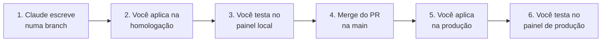

# Plano de trabalho

O mapa de tudo o que falta fazer, na ordem, para não perder nenhuma etapa. Cada etapa diz **onde**
a mudança acontece, **como testar** e **como levar para a produção**. Marque `[x]` ao concluir.

A análise que originou a lista está em [analise-topologia.md](analise-topologia.md); a revisão global de 27/09, com as prioridades consolidadas, em [analise-global.md](analise-global.md).

## Onde estamos

**Sprint atual: 13 a 23/10** — fechar a decisão 51 e a 084 entrega 2. *Situação em 11/10, fim do dia: 13 de 18 tarefas concluídas, mais o P1 e, antecipada, a 084 entrega 3 inteira (justificativa de ponto E1 a E3, migrations 66 a 72, painel 3.20.0, na produção). Faltam T09 (troca do token, 14/10, 21h), T12 (chave antiga, 16/10), T14 e T15 (fim do token na URL, 15 e 20/10 — log sem "token pela URL" desde 10/10, 14h49) e T16 (revisão, 22/10). Medidas do Scrum Master aprovadas em 11/10: chave do cofre guardada fora do Supabase (**cumprida em 11/10**: cópia conferida pela impressão digital); teste de PDF de 5 MB na homologação (antes de 15/10); nada publicado em 14 e 16/10 além da T09 e da T12.* Plano, encadeamento e fichas em
[`sprint-13-23-out.html`](sprint-13-23-out.html).

| Peça | O que é | Situação |
|---|---|---|
| Máquina Linux no Mac | Onde você roda o painel, os comandos do Supabase e os scripts | Pronta |
| Homologação | Projeto Supabase `infoxtec-escalas-dev` (`oruwnlxyvznpigbpjjbx`), com dados fictícios, sem WhatsApp nem ligações reais | **Migrations 01 a 76** e as três Edge Functions — igual à produção (11/10) |
| Produção | Projeto Supabase `infoxtec-escalas` (`zpckrxydqqmmcrphrkxz`) + painel na Vercel | **Migrations 01 a 76** (11/10), as três Edge Functions, o painel 3.21.0 e 5 tarefas agendadas |
| Repositório | GitHub `infoxtec/infoxtec-escalas`. A `main` é o que vale para a produção | `main` igual à produção e à homologação (migrations 01 a 76, 11/10) |

## Regras combinadas (26/09)

| Tipo de mudança | Caminho |
|---|---|
| **Registro no backlog** | Vai direto para a produção, feito pelo Claude, só na tabela do backlog. Numeração automática em sequência única: 001, 002... |
| **Qualquer outra mudança** (banco, painel, Edge Functions) | Claude aplica na homologação, vocês dois testam, e só com o seu comando vai para a produção, pelo ciclo abaixo |

## O ciclo de toda mudança

Sempre o mesmo caminho, sem atalho:

| Passo | Quem | Comando ou ação |
|---|---|---|
| 1 | Claude Code | Escreve a migration ou o código numa branch e abre o pull request |
| 2 | Você, no Linux | `cd ~/infoxtec-escalas && git fetch && git checkout <branch> && git pull` e depois `./scripts/aplicar-homologacao.sh` |
| 3 | Você | `./scripts/painel.sh iniciar` (fica no ar com o terminal fechado) e o teste descrito na etapa |
| 4 | Você, no GitHub | Aprovar e fazer o merge do pull request |
| 5 | Você, no Linux | `git checkout main && git pull` e depois `./scripts/aplicar-producao.sh` |
| 6 | Você | O mesmo teste do passo 3, no painel de produção |

**Nunca rode SQL direto na produção**, nem os comandos `supabase migration repair` ou
`supabase db pull` que o Supabase sugere quando algo dá errado. Se algo falhar, pare e traga a
mensagem completa.

### Os dois scripts

| Script | O que faz | Travas |
|---|---|---|
| `scripts/aplicar-homologacao.sh` | Liga na homologação, mostra a situação das migrations e aplica | Confere que o link ficou na homologação antes de aplicar |
| `scripts/aplicar-producao.sh` | Liga na produção, mostra o que vai ser aplicado e só aplica se você digitar `PRODUCAO` | Recusa rodar fora da `main`, com arquivo alterado ou com a `main` desatualizada; ao terminar, sempre volta o link para a homologação |

Painel de produção sem banco novo (só mudança de tela): o passo 5 é o próprio merge, porque a
Vercel publica a `main` sozinha.

## Etapas

As etapas estão em ordem. Dentro de cada bloco, uma etapa só começa quando a anterior terminou.

### Bloco 1: fechar o que já foi feito

- [x] **1. Confirmar 39 a 41 em produção.** No Linux: `npx supabase link --project-ref zpckrxydqqmmcrphrkxz`, `npx supabase migration list` (39, 40 e 41 precisam aparecer em Remote) e voltar com `npx supabase link --project-ref oruwnlxyvznpigbpjjbx`.
      *Teste no painel de produção:* abrir um documento enviado por arquivo; criar uma habilidade; marcar as habilidades de um técnico. Os três falhavam antes.
- [x] **2. Agendar a limpeza de logs na produção.** No SQL Editor da produção, rodar a última linha de `supabase/setup/cron.sql`. É a única exceção à regra de não rodar SQL na produção, porque agendamento não é migration.
- [x] **3. Merge do pull request e aplicação na produção.** Leva para a produção o que ainda está só na homologação:
      - migration 42: itens de documentos no backlog;
      - migration 43: backlog numerado em sequência (001, 002...);
      - painel 3.2: números com três dígitos e a faixa de ambiente no painel local.

      Como: no GitHub, *Merge pull request*; a Vercel publica o painel sozinha. No Linux, `git checkout main && git pull` e `./scripts/aplicar-producao.sh`.
      *Teste:* na aba Roadmap da produção, todos os itens com número de três dígitos, sem repetição, e os três de documentos no fim da lista do backlog. A partir daqui, a `main` é igual à produção.

### Bloco 2: ambiente e processo (configuração, sem código)

- [x] **4. Preview da Vercel apontando para a homologação.** Feito com `scripts/configurar-vercel-homologacao.sh`: Production usa a produção; Preview e Development usam a homologação.
      *Teste:* abrir o preview de um PR e conferir que só aparecem os dados fictícios.
- [ ] **5. Login da homologação.** Supabase dev → Authentication → URL Configuration: incluir `http://localhost:5173/**` e `https://*.vercel.app/**`; desligar o cadastro público.
- [x] **6. Senha forte, sem custo.** *Concluída em 27/09: mínimo de 8 caracteres com letras e números nos dois projetos (decisão 36) e recusa de senha vazada no painel.*
      - *Configuração (você):* nos dois projetos, Authentication → tamanho mínimo de senha **12**.
      - *Código (Claude, pelo ciclo):* **feito no painel 3.4 (PR #3).** Ao criar ou trocar a senha, o painel consulta a base pública de senhas vazadas (Have I Been Pwned). Só os 5 primeiros caracteres do *hash* da senha saem do navegador; a senha nunca. Senha encontrada é recusada.
      *Teste:* tentar cadastrar `Senha@123456` e ver a recusa.

### Bloco 3: banco (cada uma é uma migration: homologação, teste, produção)

- [x] **7. Alerta de motor parado.** *Na produção desde 27/09: migration 44 e agendamento `vigia-motor`.* Se o motor não rodar com sucesso por mais de 5 minutos, os supervisores recebem aviso, e a aba Operação mostra a última execução.
      *Teste na homologação:* simular falha do motor e ver o alerta registrado.
      *Passo manual na produção, depois do script:* no SQL Editor da produção, rodar a linha `vigia-motor` de `supabase/setup/cron.sql`. Sem ela o alerta nunca dispara; a aba Operação avisa quando o vigia não está agendado.
- [x] **8. Validação dos parâmetros (`config`).** *Na produção desde 27/09 (PR #3).* Gravar um valor inválido (por exemplo, texto em `max_tentativas`) passa a ser recusado, em vez de quebrar o motor.
- [x] **9. Limpeza do legado.** *Na produção desde 27/09 (PR #3).* Remover as funções da bancada de teste (`fn_teste_wa_*`) e o índice duplicado `idx_notif_wa`.
- [x] **10. Fechar escalas passadas e liberar o horário da recusa.** *Na produção desde 27/09 (PR #3).* Decidido em 27/09 (decisões 30 e 31): confirmada vira concluída 5 minutos depois do término previsto; recusa libera o horário e o técnico volta para "sem escala".
      *Teste:* escala confirmada que terminou há mais de 5 minutos aparece como concluída; criar uma escala no mesmo horário de uma recusada é aceito.
- [x] **10b. Robustez do banco** (análise global, 27/09). *Na produção desde 27/09 (PR #3).* Índices nas chaves estrangeiras (excluir técnico com 260 escalas: de 3,5 s para 0,04 s), trava contra motor em dobro, apagar o conteúdo enviado das notificações depois de 90 dias.
- [ ] **10c. Avisos técnicos por dois caminhos** (decisão 34). *WhatsApp de aviso técnico na produção desde 27/09 (PR #3); falta criar o monitor no healthchecks.io ([roteiro](roteiro-producao.md), D5).* WhatsApp pela Evolution para os supervisores e para David Cerqueira (motor parado, banco perto do limite) e monitor externo gratuito (healthchecks.io) por e-mail e Telegram para quando a Evolution ou o Supabase caem.

### Bloco 4: segurança das Edge Functions

- [x] **11. `documento-ocr` valida o login por conta própria**, sem depender só da configuração de publicação. *Na produção desde 27/09 (PR #3).* Corrigido junto: o botão de leitura na nuvem falhava sempre no navegador (faltava CORS) e a chave do Google podia vazar numa mensagem de erro.
- [ ] **12. `voz-escala` confere a assinatura da Twilio** (`X-Twilio-Signature`) em vez de confiar só no token da URL. *Na produção desde 27/09, em observação; falta ligar o bloqueio.* Começa em observação; o bloqueio é ligado depois de conferir o log ([telefonia.md](telefonia.md)). **Prazo:** ~~10 ligações reais em até 30 dias~~ — em 10/10 havia zero ligações (disparo automático desligado). **Decisão 54 (10/10, responsável):** sem bloqueio; a assinatura segue em observação. URA automática ativada, só em dia útil, das 08:00 às 20:00, fora de feriado (migration 64).
- [x] **13. Trocar a biblioteca `xlsx`** da importação de planilhas. *Na produção desde 27/09 (painel 3.4.2, PR #8): xlsx 0.20.3 oficial guardado em `web/vendor/` (decisão 37), zero vulnerabilidades; o CI bloqueia vulnerabilidade alta.*
      *Teste:* importar a mesma planilha antes e depois.

Edge Function não é migration: é publicada com `npx supabase functions deploy <nome>`, primeiro no projeto dev e depois no de produção, pelo mesmo ciclo.

### Bloco 5: proteção automática

- [x] **14. CI no GitHub.** *Valendo desde o merge do PR #3 (27/09).* Em todo pull request: compilar o painel, reaplicar todas as migrations num banco vazio e rodar o `plpgsql_check`. Pega sozinho os erros que nesta análise foram encontrados à mão.
- [x] **15. Testes automáticos das regras críticas**: fuso do motor, jornada CLT, permissões por papel, habilidades. *Primeira parte em 09/10: `supabase/tests/regressao.sql` no CI (permissões, ponto, WhatsApp, jornada do ponto, carga). Concluída em 10/10 (P1 da sprint, adiantado): T12 fuso do motor — fila do WhatsApp na hora local da config, com a sessão em outro fuso, janela de envio e troca de fuso; T13 habilidades — apto, nível abaixo, faltando e técnico inativo. Suíte com 13 blocos (T1 a T13), sem pgTAP: mesmo resultado com SQL puro e uma dependência a menos.*
- [x] **15a. Endurecimento em 3 partes (decisão 51).** *Parte 1 na produção em 08/10, conferida 24 h e com teste conjunto ok em 10/10; parte 2 em operação desde 09/10 e restauração verde em 10/10; parte 3: token no cabeçalho na produção em 10/10 (troca do token e fim da URL concluídos em 15/10: troca automática pelo banco, migration 103, decisão 98); migration 63 na produção em 10/10 (0 acessos conferidos).* (1) Migration 62: nenhuma função interna executável pelo `service_role`, função nova fechada, regressão no CI. (2) Âncora da cadeia de hash do ponto no backup diário, conferida na restauração *(PR #67; primeiro backup com âncora em 09/10)*. (3) Token do webhook da Evolution no cabeçalho `x-webhook-token`, URL antiga como reserva por 3 a 7 dias, depois troca do token. Chave `service_role` antiga desativada em 16/10 (T12, junto com a `anon` antiga); tabelas e sequências revogadas na migration 63.

### Bloco 6: infraestrutura sem custo

Regra (decisão 29): nenhuma assinatura paga. Cada item abaixo usa só planos gratuitos.

- [x] **16. Desligar o Retool.** *Concluída em 27/09: senha do banco de produção trocada e conexão `infoxtec-escalas` apagada no Retool (conferido). O Retool não alcança mais o banco; os apps antigos que restam lá não têm dados.*
- [x] **17a. Evolution própria na Oracle Cloud (decisão 43).** *Concluída em 30/09: uma só Evolution 2.4 no servidor, antiga desligada (backlog 071 e 073).* *Servidor no ar em 28/09 (Oracle São Paulo, `VM.Standard.E2.1.Micro`, 163.176.68.206), número 71 4101-9605 conectado na instância `infoxtec` e envio testado; virada feita em 28/09 (2.4.0-rc2, botões ligados); falta desligar a antiga (parte F) e consolidar o servidor numa versão.* Fecha `SEG-01` e `SEG-02`.
- [ ] **17. Painel no Cloudflare Pages (gratuito).** O plano gratuito da Vercel proíbe uso comercial; o do Cloudflare Pages permite, também publica a `main` sozinho e tem preview por branch.
      *Como:* criar o projeto no Cloudflare ligado ao GitHub (pasta `web`, comando `npm run build`, saída `dist`), cadastrar as variáveis de produção e de preview, converter os cabeçalhos de segurança do `vercel.json` para o arquivo `_headers`, e atualizar os endereços de login no Supabase.
      *Teste:* o painel abre no endereço novo, com login, e a Vercel só é desligada depois de uma semana rodando em paralelo.
- [x] **18. Backup diário gratuito.** *Funcionando desde 27/09: primeiro backup da produção (80 KB, criptografado) e teste de restauração conferido (13 técnicos, 8 locais, 47 escalas, 91 notificações, 1 documento, 3 usuários, 60 itens de backlog).* O Supabase gratuito não tem backup com restauração pelo painel. Substituto: toda madrugada, o GitHub Actions (gratuito em repositório privado) faz uma cópia completa do banco de produção, criptografada com uma senha que só você guarda, e mantém as últimas 30.
      *Teste de restauração:* uma vez por mês, o mesmo robô restaura a cópia mais recente num banco temporário, confere as contagens e apaga o banco. Os dados reais nunca vão para a homologação (LGPD).

### Bloco 7: gestão de documentos (backlog 14 a 16)

Pedidos em 26/09. Análise em [backlog.md](backlog.md), itens 14 a 16. Envolvem banco (migration) e painel (tela), pelo mesmo ciclo. As decisões pendentes precisam de resposta antes de começar.

- [ ] **19. Pré-visualização e download com aviso de LGPD** (backlog 15). Vem primeiro porque as outras duas usam o visualizador.
      *Teste:* enviar um PDF e uma foto e ver o documento ao lado dos campos; baixar um documento e conferir o aviso e o registro do download.
- [ ] **20. Classificação obrigatória: ASO, NR, suspensão ou advertência** (backlog 16). *Decidido em 27/09 (decisão 32): suspensão e advertência só para administradores, guardadas 3 anos; CNH continua.*
      *Decidir antes:* quem vê suspensão e advertência; se CNH continua como categoria.
      *Teste:* tentar gravar um documento sem categoria e ver a recusa; classificar os antigos pela lista.
- [ ] **21. Identificação automática do tipo e do técnico** (backlog 14). *Decidido em 27/09 (decisão 32): o cadastro passa a ter CPF.*
      *Decidir antes:* se o cadastro passa a ter CPF.
      *Teste:* enviar uma pasta com documentos de técnicos diferentes e conferir as sugestões.

### Bloco 8: arquitetura (projetos maiores)

- [ ] ~~**22. WhatsApp pela API oficial da Meta.**~~ *Fora do plano (decisão 33, 27/09): a Evolution continua; mitigação na etapa 10c e na contingência de `operacao.md`.*
- [ ] **23. Início da escala como instante (`timestamptz`)**, eliminando a classe de erro de fuso na raiz.
- [ ] **24. Esquema privado: só as funções `app_*` expostas na API** (backlog 074). Tabelas e funções
  `fn_*` saem do `public` para um esquema `interno`, que a API não expõe. Defesa em profundidade e
  requisito de maturidade para o SaaS comercial e para certificação. Roteiro: (1) inventário de
  dependências (funções, views, gatilhos, cron, Edge Functions, `search_path`); (2) migration que move e
  ajusta o `search_path` das `app_*` para `public, interno, extensions`; (3) homologação com teste
  completo do painel, do motor e do webhook, mais o `plpgsql_check`; (4) revisão do `seguranca`; (5)
  produção fora da janela de envio. Fazer antes ou junto do multi-tenant (backlog 029).

### Pendências da revisão de segurança do PR #3 (baixas)

- [x] `monitor_ping_url` aceitar só `https://hc-ping.com/<uuid>`. *Migration 81, 13/10.*
- [x] `webhook-evolution` recusar corpo sem `content-length` (411) antes de ler. *Feito de outro jeito em 13/10: o corpo é lido em fluxo com teto de 5 MB (413 acima), com ou sem `content-length` — o 411 derrubaria a Evolution se ela enviar em partes.*
- [x] CORS da `documento-ocr` limitado aos domínios do painel. *13/10: produção, pré-visualizações da Vercel e `localhost:5173`.*
- [x] Registrar em `decisoes.md` que o GitHub guarda cópia cifrada dos dados (tratamento LGPD). *Decisão 70, 13/10.*

### Bloco 9: produto (análise global de 27/09, aprovado pelo responsável)

- [x] **24. Motivo de recusa estruturado e tempo de resposta** (backlog 064). *Na produção desde 28/09 (migrations 47 e 48, painel 3.5, PR #12) — e o motivo de saúde saiu do sistema na migration 49 (decisão 40).* (fase 0 de [agente-ia.md](agente-ia.md)). Base dos indicadores: sem ela, cada semana é dado perdido.
- [x] **25. Editar e reagendar escala** (backlog 065). *Na produção desde 28/09 (migrations 47 e 48, painel 3.5, PR #12)*, com "substituir técnico" depois de uma recusa.

### Bloco 10: Módulo Registro de Ponto (backlog 075 a 089, decisão 48)

Plano completo em [modulo-registro-de-ponto/plano.md](modulo-registro-de-ponto/plano.md). A
legalização corre em paralelo; nada vale como ponto oficial antes do parecer, do INPI e de 30 dias de
avaliação.

- [ ] **25b. Inconsistências do ponto, intervalo e HE com aprovação** (decisão 100, aprovada em 16/10).
  Registros mínimos por faixa de jornada bloqueando o fechamento (opção por empresa), gestor só aprova,
  reprova ou abona (nunca cria marcação; sai a ação "incluir"), aviso no dia seguinte do intervalo não
  registrado, comprovante "retorno a partir de HH:MM", alerta de intervalo abaixo de 1 h ao funcionário e
  ao gestor, HE programada ou aprovada pelo gestor no início (sem travar a marcação). Depois da T12 e do
  fechamento de maio do Renato; PR até 23/10.

- [ ] **26. Legalização** (076–079): parecer REP-P (Gabriel), convenção coletiva e folha (Andreia), e-CNPJ e INPI, atestado, aviso de privacidade, termo de uso, contrato.
- [ ] **27. F1 Base de dados** (080–081): empresas, CPF e matrícula, local com área, marcações imutáveis com NSR. *080 e 081 na produção desde 07/10 (migrations 53 e 54).* Pendências da revisão do `seguranca` (P3): decidir guarda e anonimização do CPF do desligado (com o Gabriel, item 076); registrar quem alterou CPF ou matrícula, sem gravar o valor (entra com o AFD, 085). Da revisão do pacote 2 (081): **âncora externa da cadeia** — guardar o último hash de cada empresa todo dia fora do Supabase, antes da produção do módulo; **comprovante por canal** — CPF inteiro só no app, mascarado no WhatsApp e na URA, e nunca registrar o comprovante em log (condição do pacote 3); quem chama `fn_ponto_registrar` tira o funcionário da sessão, do telefone conferido ou do PIN, nunca de parâmetro do cliente. Da revisão do pacote 3 (082), para decisão do responsável: **CAPTCHA** (Cloudflare Turnstile, gratuito até certo volume) no pedido de código se houver abuso, e **código de 8 dígitos**; e, P3, um `Content-Security-Policy` no `vercel.json` e servir `/ponto` em subdomínio próprio. Da revisão do pacote 4 (083/090), P3: guardar em `origem` o tipo da localização do WhatsApp (tempo real ou fixa) e mostrar no painel (pede recriar `fn_ponto_registrar`); ~~não interceptar palavras do ponto quando houver ocorrência de recusa aberta aguardando detalhe~~ *(feito: migration 84, 13/10)*; descartar grupo e canal também em `fn_wh_mensagem`. Da revisão da migration 57, P3: ~~resposta de confirmação de escala antiga sem local ainda diz "local a confirmar"~~ *(encerrado sem mudança: não se envia escala sem local, decisão 73)*; mensagem de erro mais clara ao editar escala antiga sem local. Da revisão da migration 59, P3: botão antigo do ponto tocado sem conversa aberta pula o menu (aceitar só com conversa); medir na produção se o `sendButtons` do menu chega e, se falhar, mandar também o texto. Da revisão da migration 60: **testar no Android e no iPhone** se o alfinete arrastado no mapa ("Enviar esta localização") chega sem `accuracyInMeters` — se sim, recusar como lugar do mapa (P2); conferir se a localização em tempo real repete o `key.id` nas atualizações (P3). Da revisão da migration 61 (P3): ~~jornada de 4 a 6 h sem intervalo não gera aviso~~ *(feito: migration 83, 13/10)*; hora extra usa `jornada_min` global (falso positivo em 44 h com compensação ou 12x36 — regra por contrato/convenção, L2); jornada que cruza a meia-noite fica dividida; papel leitura e nome no aviso ao gestor: **decidido em 10/10** (decisão 52), implementado na 084 entrega 2.
- [x] **28. F2 App web do funcionário** (082) e **F3 WhatsApp** (083). *F2 na produção em 07/10 (migration 55). F3 e tela Ponto do gestor (090) na produção em 08/10 (migrations 56 a 60).*
- [ ] **29. F4 Jornada e espelho** (084) e **F5 AFD e AEJ** (085). *AFD entrega 1 (versão de conferência, migration 87) na produção em 13/10 e validada pela Andreia; faltam os tipos 2, 5 e 6, a assinatura CAdES e o AEJ. Desempenho (revisão do `seguranca`): 4,2 s com 100 mil marcações; antes de um cliente passar de ~50 mil, guardar o hash do AFD por marcação ou um ponto de controle. Pendências P3: CNPJ alfanumérico (vigente desde 07/2026) a conferir com a Andreia.* *084 entrega 1 (avisos da CLT e espelho) na produção em 09/10 (migration 61); entrega 2 (ajustes com justificativa) na sprint de 13 a 23/10.*
- [ ] **30. F6 URA de contingência e anti-fraude** (086–087).
- [ ] **31. F7 Avaliação de 30 dias na Infoxtec** (088) e **F8 venda** (089).

## Registro

| Data | Etapa | Homologação | Produção |
|---|---|---|---|
| 26/09 | Migrations 39, 40 e 41 | Aplicadas e testadas | Aplicadas e testadas (Bloco 1) |
| 26/09 | Limpeza de logs agendada | Não se aplica | Agendada |
| 26/09 | Migration 42: itens de documentos no backlog | Aplicada e testada | Aplicada e conferida |
| 26/09 | Migration 43 + painel 3.2: numeração 001 do backlog | Aplicada e testada | Aplicada e conferida |
| 26/09 | Merge do PR #1: `main` igual à produção | Não se aplica | Concluído |
| 26/09 | Vercel: Preview e Development na homologação | Configurado | Production sem alteração |
| 26/09 | Migration 44 + painel 3.3: alerta de motor parado, logomarca, painel em segundo plano | Aplicada e testada pelo Claude; teste conjunto pendente | Aguardando sua ordem |
| 27/09 | Merge do PR #2: painel 3.3 (alerta de motor, logomarca) | Não se aplica | Painel publicado; migration 44 pendente |
| 27/09 | Migrations 45 e 46, Edge Functions, CI, backup, painel 3.4 (etapas 8 a 12, 14, 18, 10b, 10c) | Aplicadas e testadas; teste conjunto aprovado | Aplicadas pelo responsável (migrations 44 a 46, Edge Functions, `vigia-motor`) e conferidas |
| 27/09 | Painel 3.4.1: sessão não cai mais sozinha (decisão 35, PR #4) | Testado em navegador com duas abas | Publicado |
| 27/09 | Backup diário e teste de restauração (etapa 18, PR #6) | Não se aplica | Primeiro backup e restauração conferidos |
| 27/09 | Painel 3.4.2: senha 8 com letras e números (etapa 6) e xlsx 0.20.3 (etapa 13) | Testado (importação xlsx, xls e csv) | Publicado (PR #8) |
| 27/09 | Retool desligado (etapa 16): senha do banco trocada, conexão apagada | Não se aplica | Conferido |
| 27/09 | Migrations 47 e 48 + painel 3.5: motivo de recusa (064) e editar/substituir escala (065) | Aplicada e testada; plpgsql_check zero | Aguardando ordem |
| 28/09 | Migrations 47, 48 e 49 na produção (o script aplicou as três de uma vez) | Sem teste conjunto prévio: aplicado direto pelo responsável, a pedido, com as duas consultas de dependência do tipo conferidas antes | **Produção em 01 a 49** |
| 28/09 | Migration 49 + painel 3.5.1: sem motivo de saúde na recusa (decisão 40) e sem vínculo por Google Drive (decisão 41) | Pendente o teste de ponta a ponta no painel | Produção; **falta aplicar a 49 na homologação** |
| 28/09 | Convergência dos ambientes: a migration 49 chegou à homologação | Não se aplica | Homologação em 49, igual à produção |
| 28/09 | Migration 50 + painel 3.5.2: o modo Drive sai da estrutura — colunas, view e três funções (decisão 42) | Testado: selo "Privado", envio e abertura de arquivo, e as duas consultas de verificação | **Produção e homologação em 01 a 50** |
| 28/09 | Evolution própria: `infra/evolution/` e roteiro (decisão 43) | Não se aplica | Aguardando o servidor na Oracle |
| 28/09 | Evolution própria no ar (E2.1.Micro, sem Redis) e número conectado; parte D concluída | Envio de teste entregue | Falta a virada (parte E) |
| 28/09 | Virada da produção (parte E): SEG-01 e SEG-02 fechados; Evolution 2.4.0-rc2 com botões | Escala de teste enviada em 26 s e confirmada | Falta parte F (desligar a vluma) e consolidar o servidor |
| 29/09 | Migration 51 + painel 3.6.0: Administração do Sistema > Checklist (saúde de Evolution, Supabase, tabelas, Twilio, GitHub, Vercel) | Homologação: plpgsql_check zero, 13 itens, limite de 10 s; revisão do `seguranca` sem bloqueio | Aguardando teste conjunto e ordem |
| 30/09 | Consolidação do servidor Evolution (backlog 073): 2.4 única, 2.3.7 e aparelhos antigos desligados | Checklist open, escala de teste enviada e confirmada | Concluído; falta a limpeza e o reinício do servidor |
| 30/09 | Migration 52: índices das 5 chaves estrangeiras; homologação alinhada à produção (trava 20260928235626) | Homologação: plpgsql_check zero; linter sem chave estrangeira sem índice | Aguardando merge e aplicação na produção |
| 01/10 | Planejada a etapa 24 (esquema privado, backlog 074) | Não se aplica | Na fila |
| 04/10 | Painel 3.7.0: identidade da marca Trilha (logo, assinatura, grito; decisão 46) | Build e tela de login conferidos; só painel, sem banco | Concluído: PR #50, publicado em 04/10 |
| 04/10 | Painel 3.8.0: tela principal com botões grandes, Checklist Sistema, voltar em cada tela | Build e telas conferidos na homologação (login simulado); aprovado pelo responsável | Concluído: PR #51, publicado em 04/10 |
| 04/10 | Documentação da marca v5, plano de branding (`docs/marca.md` §11), plano comercial e temas COM-11/12 | Não se aplica | Concluído |
| 04/10 | Migrations **51** (Checklist Sistema) e **52** (índices) na produção | Confirmado pelo responsável | **Produção em 01 a 52**; a aba Checklist Sistema passa a funcionar |
| 05/10 | Decisão 47 (cenário A): DeepSeek sem SQL e com revisão do Claude; protocolo dos agentes em `docs/equipe.md` | Revisão do Claude no PR #53 | Aguardando merge |
| 06/10 | Módulo Registro de Ponto planejado: backlog 075 a 089, decisão 48, pasta `docs/modulo-registro-de-ponto/` | Não se aplica | Aprovado; legalização e F1 a iniciar |
| 06/10 | Migration 53 + painel 3.9.0: Ponto pacote 1 (empresas, CPF/matrícula, área do local) | Homologação: plpgsql_check zero (97 funções), 14 testes de regra em transação desfeita | Concluído: produção em 07/10 |
| 06/10 | Migration 54: Ponto pacote 2 (marcações imutáveis, NSR por empresa, hash encadeado, ajustes, fn_ponto_registrar) | Homologação: plpgsql_check zero, 14 testes em transação desfeita (NSR 1-2-3, cadeia íntegra, fora da área sinalizado, exclusão bloqueada) | Concluído: produção em 07/10 |
| 07/10 | Migration 55 + painel 3.10.0: Ponto pacote 3 — login do funcionário (CPF + código), sessão única, app `/ponto` com comprovante; decisão 49 | Homologação: plpgsql_check zero, 16 testes do fluxo em transação desfeita; app testado no navegador com respostas simuladas (a rede deste ambiente não alcança o Supabase) | Concluído: produção em 07/10 |
| 07/10 | Migration 56 + painel 3.11.0: ponto pelo WhatsApp (083), lembrete do almoço e tela Ponto do gestor (090) | Homologação: plpgsql_check zero, 11 cenários do WhatsApp simulados em transação desfeita (menu, palavras, localização recusada, duplicada, de quem não tem ponto), lembrete uma vez por dia, telas do gestor | Concluído: produção, testado pelo responsável (08/10) |
| 08/10 | Migration 57 + painel 3.11.2: escala exige local (urgente) — gatilho na tabela e trava no envio; painel sem a opção "a confirmar" | Homologação: criar sem local recusado, apagar local recusado, editar sem local recusado, com local cria e monta mensagem; plpgsql_check zero | Concluído: produção, testado pelo responsável (08/10) |
| 08/10 | Migration 58 + painel 3.12.0: bairro e cidade das marcações pelo OpenStreetMap (decisão 50), coluna GPS | Homologação: consulta real ao Nominatim (Pituba, Salvador/BA), app_ponto_geo, plpgsql_check zero | Concluído: produção, testado pelo responsável (08/10) |
| 08/10 | Migration 59: menu do ponto no WhatsApp com botões e volta ao menu | Homologação: 11 cenários em transação desfeita (menu, inválido, botão, botão interativo, botão de escala e falso, citação, cancelar), plpgsql_check zero | Concluído: produção, testado pelo responsável (08/10) |
| 08/10 | Migration 60: localização encaminhada ou reenviada não bate ponto (bug achado no teste) | Homologação: encaminhada por data.contextInfo e por messageContextInfo recusadas, coordenada repetida recusada, leitura nova aceita; plpgsql_check zero | Concluído: produção, testado pelo responsável (08/10) |
| 09/10 | Migration 61 + painel 3.13.0: jornada e avisos da CLT no ponto (084, entrega 1), espelho de jornada | Homologação: dia com intervalo de 40 min e 3h50 de HE (dois avisos), interjornada de 9h30, aviso antes da volta com 20 min, gestor avisado uma vez, espelho; plpgsql_check zero | Concluído: produção em 09/10, testado pelo responsável |
| 09/10 | Migration 62: permissões sem `service_role`, default privileges, `supabase/tests/regressao.sql` no CI (decisão 51, etapa 15a parte 1) | Homologação: suíte T1 a T9 verde (2.000 marcações em 2,5 s; 300 mensagens em 0,4 s) | Concluído: PR #66, produção em 08/10, conferida 24 h em 09/10 (`service_role` executa 0 funções) |
| 09/10 | Etapa 15a parte 2: âncora da cadeia do ponto no backup e conferência na restauração | Homologação: 7 cenários (íntegro, adulteração simples, reescrita consistente da cadeia, NSR e hash divergentes, âncora vazia, marcação durante o backup); scripts testados com psql | Concluído: PR #67; primeiro backup com âncora verde em 09/10 |
| 10/10 | Revisão do backlog (PO e Scrum Master) e sprint de 13 a 23/10 aprovada (`docs/sprint-13-23-out.html`); decisões A, B e C da 084 (decisão 52) | Não se aplica | Sprint aprovada; Kanban da produção atualizado em 10/10 (item novo 091, endurecimento) |
| 10/10 | Teste conjunto da parte 1 (migration 62): marcação pelo app, pelo WhatsApp e Registro de Ponto | Bem-sucedido (responsável) | Concluído |
| 10/10 | T05 adiantada: restauração manual com âncora (GitHub Actions, execução 38070843063) | Verde: restauração, contagens e "Conferir as âncoras da cadeia do ponto" | Concluído; parte 2 comprovada de ponta a ponta |
| 10/10 | T06 adiantada: `webhook-evolution` lê o token do cabeçalho `x-webhook-token`; URL aceita na transição, com aviso no log; procedimentos do `/webhook/set` com cabeçalho | Local (Deno + Postgres): 6 cenários (cabeçalho certo, errado com URL certa, vazio, legado certo e errado, sem token); Evolution 2.3+ envia `webhook.headers` (código-fonte conferido) | Aguardando merge e publicação (T07) |
| 10/10 | T07 adiantada: `webhook-evolution` publicada na produção (versão 66) e Evolution 2.4.0 reapontada com o token no cabeçalho, mesmo token; resposta do `/webhook/set` (201) apagada | Responsável: "ponto" e escala pelo WhatsApp ok; log sem "token pela URL (legado)" depois das 14h49 e eventos novos aceitos às 14h53 | Concluído; falta a troca do token (17/10) e o fim da URL (22/10) |
| 10/10 | T08 adiantada: migration 63 — `anon`, `authenticated` e `service_role` sem tabela, view nem sequência do `public`; default privileges fechados | Homologação (leitura): `service_role` alcançava 33 de 42 tabelas/views e as 3 sequências; todos os objetos do `public` são do `postgres`; nenhum código usa a chave `service_role`. CI: suíte T1 ampliada | Concluído: homologação e produção em 10/10 (PR #71; 0 acessos nas duas) |
| 10/10 | Migration 63 aplicada na homologação (`aplicar-homologacao.sh`, pelo responsável); conector do Supabase não grava (o servidor pede confirmação que não chega à sessão), então migrations passam a ir para a homologação pelo script | Leitura: versão 20261010180000 registrada; `anon`, `authenticated` e `service_role` com 0 acessos a tabela, view ou sequência do `public` | Concluído na homologação |
| 10/10 | Migrations 63 e 64 na produção (`aplicar-producao.sh`); decisão 54: sem bloqueio da Twilio, URA automática só em dia útil, das 08:00 às 20:00, fora de feriado (80 feriados de 2026 a 2030) | Homologação: plpgsql_check 0 erros em 130 funções, regra testada; produção (leitura): versões 63 e 64 registradas, 0 acessos da API, 80 feriados | Concluído; falta publicar a `voz-escala` e ligar `ligacao_ativa` (T18) |
| 10/10 | T11 e T13 adiantadas: migration 65 + painel 3.14.0 — ajustes de ponto com justificativa (084 entrega 2, decisão 52); revisão do `seguranca` sem P1, dez achados corrigidos no PR #75 | CI: regressão T1 a T11 verde; homologação: `plpgsql_check` zero em 132 funções; produção conferida (coluna, 2 índices, permissões, `service_role` 0) | Concluído: produção em 10/10 |
| 10/10 | P1 adiantado: T12 fuso do motor e T13 habilidades na regressão (etapa 15) | CI do PR #76: regressão T1 a T13 verde num banco vazio | Concluído |
| 10/10 | T18: `voz-escala` com a reserva atômica da ligação na produção (versão 72) e `ligacao_ativa = true`; 084 movida para Feito no Kanban | Conferido: ativa, janela 08:00–20:00, `fn_ligacao_permitida()` falsa no sábado | Concluído; primeira ligação possível em 13/10, 08:00 |
| 11/10 | 084 entrega 3, E1: justificativa de ponto pelo funcionário (app e WhatsApp "ajuste"), aprovação do gestor, abono e falta no espelho — migration 66, painel 3.15.1; decisões 55 a 59; persona `juridico` | CI T1 a T14 verde; homologação `plpgsql_check` zero em 145 funções; teste conjunto ok (aprovar, negar — tela de negar corrigida no PR #78); produção aplicada | Concluído: PRs #77 e #78, produção em 11/10. Próximo: E2 (saúde, família e convocação, com cofre criptografado) |
| 11/10 | Pendência com prazo (revisão do `seguranca` da migration 68): executor da guarda — anonimizar texto livre de pedidos e descartar documentos do cofre ao fim de 5 anos (decisões 56 e 59) e testar PDF de 5 MB contra o tempo-limite do `anon` | — | **Prazo: antes do primeiro cliente externo com o ponto em produção** |
| 11/10 | 084 entrega 3, E2 e decisão 60: atestado e faltas com documento no cofre criptografado (migration 68, painel 3.16.0) e validade do atestado — sem ponto e sem escala no afastamento, alta médica libera (migration 69, painel 3.17.0) | CI T1 a T16 verde; homologação `plpgsql_check` zero em 159 funções; teste conjunto ok (atestado, cofre, afastamento, alta); produção conferida (versão 69, chave do cofre, gatilhos, `anon` sem acesso ao cofre, `service_role` 0) | Concluído: PRs #80 e #81, produção em 11/10. Falta: chave do cofre guardada fora do Supabase; E2b (documento pelo WhatsApp) |
| 11/10 | 084 entrega 3, E2b, E2c e cofre contra print: documento pelo WhatsApp direto ao cofre (migration 70, decisão 61); timbre com QR, registro sequencial por empresa e conferência de integridade (migration 71, painel 3.18.0, decisão 62); termo de sigilo, documento oculto nas teclas de captura e fechamento em 3 min (painel 3.19.0, decisão 63) | CI T1 a T18 verde; teste real no WhatsApp da produção ok (pedido aprovado, documento no cofre); timbre e QR ok na homologação; termo e ocultação no print ok; produção conferida (versão 71, documento existente registrado, gatilhos, `anon` sem conferência, `service_role` 0) | Concluído: PRs #83, #84 e #85, produção em 11/10. Pendência da decisão 61 fechada em 11/10: Evolution sem guarda de mídia conferida no servidor e download automático desligado no celular da empresa |
| 11/10 | 084 entrega 3, E3: reincidência só de Ponto (atestado e falta legal nunca contam), pedido parado há mais de 2 dias úteis com aviso aos supervisores pelo cron do ponto já existente, métrica do período (migration 72, painel 3.20.0) | CI T1 a T19 verde; `seguranca` sem P1 (P2 da reincidência corrigido no PR); homologação ok; produção conferida (versão 72, 3 funções, cron do ponto ativo, `service_role` 0) e testada pelo responsável | Concluído: PR #87, produção em 11/10. A 084 entrega 3 está completa |
| 11/10 | Medida 1 do Scrum Master: chave `COFRE_PONTO` da produção guardada no gerenciador de senhas do responsável, separada da `BACKUP_SENHA` | Impressão digital (SHA-256) da cópia igual à do Vault da produção; homologação tem chave própria, diferente | Concluído. Faltam as medidas 2 (PDF de 5 MB, até 15/10) e 3 (nada publicado em 14 e 16/10 além da T09 e da T12) |
| 11/10 | Texto do afastamento (migration 73) e alta antecipada registrada pelo gestor com a liberação médica no cofre (migration 74, painel 3.21.0, decisão 64, opção A); medida 2 do Scrum Master (documento de 4,1 MB no cofre) cumprida | CI T1 a T20 verde; `seguranca` sem P1 (P2 do rótulo "atestado" corrigido); homologação e produção conferidas (versão 74, funções, canal `painel`, `anon` sem acesso, `service_role` 0) | Concluído: PRs #90 e #91. PO busca parecer de RH para a opção B |
| 11/10 | Véspera de feriado sem alerta de escala (migration 75, decisão 65) e limpeza da estrutura (migration 76, decisão 66): Checklist confere as tarefas do agendador, 6 objetos sem uso removidos, mapa do banco por domínio; tarefa `limpeza-logs` agendada na produção (estava faltando desde a criação) | CI T1 a T22 verde; `seguranca` sem achado médio ou maior; produção conferida (versão 76, 5 tarefas ativas, objetos removidos, view de retenção mantida, `service_role` 0) | Concluído: PRs #92 e #93. Pendentes do diagnóstico do DeepSeek no backlog: avisos de supervisor por empresa (antes do 2º cliente), teto no envio de atrasos, colunas e chaves sem uso |
| 11/10 | Feriado e afastado fora da cobrança de escala no painel (decisão 65) e verificação em duas etapas opcional, com regra de obrigatoriedade pronta e desligada (migration 77, painel 3.22.0, decisão 67); `seguranca`: Storage e `documento-ocr` passam a exigir aal2 quando ligada | CI T1 a T23 verde; produção conferida (versão 77, `mfa_obrigatorio` = false, `app_exigir` e Storage com aal2, `documento-ocr` publicada com a checagem, 5 tarefas, `service_role` 0) | Concluído: PR #95. Ligar a obrigatoriedade depois que todos cadastrarem o autenticador (`docs/operacao.md`) |
| 12/10 | Teto nos avisos aos supervisores (5 escalas por execução, diagnóstico do DeepSeek item 2) e duas etapas opcional por usuário, desativar pede o código (migration 78, painel 3.23.0, decisão 68) | CI T1 a T24 verde; produção conferida (versão 78, teto 5, motor rodando com o teto, `mfa_obrigatorio` = false, 5 tarefas, `service_role` 0) | Concluído: PR #97. Backlog: registro de auditoria ao desativar as duas etapas (P3 do `seguranca`) |
| 12/10 | Avisos aos supervisores só da empresa do técnico (diagnóstico do DeepSeek item 1, pré-requisito do 2º cliente; migration 79, decisão 69) | CI T1 a T25 verde (T25b dos alertas agrupados pulado no domingo e na véspera de feriado: conferir no CI da terça); produção conferida (versão 79, função comum com empresa, motor e alertas por empresa, 1 empresa ativa — nada muda hoje, motor rodando, 5 tarefas, `service_role` 0) | Concluído: PR #99. Pendências: alerta no Checklist para supervisor ou técnico sem empresa (antes do 2º cliente); `alerta_certificacoes_dow` aceita 0 a 6 mas o alerta usa 1 a 7 (domingo impossível); registro de auditoria ao desativar as duas etapas |
| 13/10 | Checklist aponta supervisor ou técnico sem empresa; alerta de documentos aceita domingo (migration 80, pendências de 78 e 79) | CI T1 a T26 verde; produção conferida (versão 80, validação 0 a 7, item no Checklist, 5 tarefas, `service_role` 0) | Concluído: PR #100 |
| 13/10 | Endurecimento do PR #3 (pendências baixas): `monitor_ping_url` só healthchecks.io (migration 81), corpo do webhook lido com teto, CORS da `documento-ocr` só do painel, decisão 70 (cópia cifrada no GitHub). Processo: registro de plano, README, backlog e sprint passa a ir no próprio pacote | CI T1 a T28 verde; produção conferida em 13/10 (versão 82, ping restrito, `webhook-evolution` v99 e `documento-ocr` v96 publicadas, WhatsApp respondendo após a publicação, 5 tarefas, `service_role` 0) | Concluído: PR #101 |
| 13/10 | Registro de quem ativou e desativou as duas etapas, com coluna e histórico na tela Usuários (migration 82, painel 3.24.0, backlog 097) | CI T1 a T28 verde; produção conferida em 13/10 (gatilho ativo, tabela com RLS, função só para admin); teste do responsável ok | Concluído: PR #101 |
| 13/10 | Jornada de mais de 4 h e até 6 h sem intervalo passa a gerar aviso, com o texto do intervalo que faltou (CLT art. 71, §1º; migration 83) | CI T1 a T29 verde; produção conferida em 13/10 (versão 83, regra de 4 h e textos de 15 min e 1 h, 5 tarefas, `service_role` 0) | Concluído: PR #102 |
| 13/10 | Palavra e número do ponto não são capturados enquanto o técnico explica uma recusa de escala; a recusa fecha a conversa do ponto (migration 84) | CI T1 a T30 verde; produção conferida em 13/10 (versão 84, recusa fecha a conversa do ponto, regra do motivo, 5 tarefas, `service_role` 0, webhook sem erro) | Concluído: PR #103 |
| 13/10 | Comercial: matriz de capacidade atualizada contra a produção (MFA, segurança e privacidade, ponto em uso interno), seriedade na marca, decisões 73 a 77 (escala sem local, G1 canal escolhido pelo cliente, G2 Vercel até demanda, G4 estimativa até 30/11, ajustes de processo), backlog 098 a 101 | Documentação; revisão do PO e do Scrum Master | Concluído: PR #104 |
| 13/10 | Painel gerencial de aderência da escala e do ponto, aba Indicadores (migration 85, painel 3.25.0, decisão 78, backlog 099) | Migration 85 na produção em 13/10; o T31 do CI falhou por um erro no próprio teste (status de ligação inválido, `completed` em vez de `atendida`) e o PR #105 foi mergeado vermelho — teste corrigido no PR seguinte | Concluído: PR #105 (correção do teste no PR seguinte) |
| 13/10 | Dossiê de conformidade por local: situação dos documentos de cada funcionário escalado na data do serviço, impressão e registro de cada geração (migration 86, painel 3.26.0, decisão 79, backlog 100) | Homologação: função testada em transação desfeita (vencido barra, vence em breve é apto, não cadastrado barra, cancelada e outro local ficam de fora, sem sessão barrado); CI T1 a T32 verde; produção conferida em 13/10 (versão 86, tabela com RLS e sem políticas, gatilhos de só inclusão e sem truncate, função na versão final e só para authenticated, 5 tarefas, `service_role` 0) | Concluído: PR #108 |
| 13/10 | Demonstração com dados fictícios na homologação: `./scripts/demo-homologacao.sh criar` e `apagar` (empresa de CNPJ fictício, 10 técnicos sem CPF e com DDD 00, 5 locais, uma semana de escalas com respostas pelo WhatsApp e pela URA, documentos para o dossiê; decisão 80, backlog 101) | Homologação: criação testada em transação desfeita (54 escalas, Indicadores e Dossiê preenchidos); T33 no CI cria, apaga e confere que nada sobra. 1ª execução do responsável falhou: `db query --project-ref` exige o link; o script passou a vincular e conferir o projeto antes (como o `aplicar-homologacao.sh`) | Concluído: PR #109 e #110; demonstração montada e conferida no painel pelo responsável em 13/10 |
| 13/10 | AFD do REP-P, versão de conferência (F5 entrega 1): cabeçalho com CRC-16, marcações do tipo 7 com hash SHA-256 encadeado, trailer, ISO 8859-1 e CR LF; botão em Registro de Ponto para o admin; cada geração registrada (migration 87, painel 3.27.0, decisão 81, backlog 085) | Homologação: gerado em transação desfeita (302, 137 e 64 posições; CRC de referência 2189; acento preservado; 4,2 s com 100 mil marcações); T34 no CI | Concluído: PR #111; produção conferida em 13/10 (versão 87, tabela com RLS e imutável, função só para authenticated, `afd_leiaute_conferido` = false, CRC 2189 na produção, 5 tarefas, `service_role` 0) |
| 13/10 | Espelho de ponto mensal com registro e QR público, parte A: o gestor emite o espelho de um mês encerrado (cópia congelada com SHA-256, registro por empresa e código de verificação), a lista mostra a situação e o QR abre `/v` sem login e sem dado pessoal (migration 88, painel 3.28.0, decisão 82). Parte B: WhatsApp, assinatura desenhada no app e PDF | Homologação: emissão, reemissão sem mudança, bloqueio de alteração, assinatura e conferência testados em transação desfeita; T35 no CI; produção conferida em 13/10 (versão 88, tabelas com RLS, gatilhos e índice de versão vigente, conferência pública só para anon, emissão só para authenticated, 5 tarefas, `service_role` 0) | Concluído: PR #112 |
| 13/10 | Espelho mensal, parte B: o gestor envia o link pelo WhatsApp; o funcionário confere no app do ponto, desenha a assinatura e confirma; a assinatura fica amarrada à versão (hash com espelho, imagem, hora e origem); PDF pela impressão, com o QR; o gestor vê e imprime (migration 89, painel 3.29.0, decisão 82) | Homologação: envio (trava da homologação), lista e espelho do funcionário, versão diferente recusada, assinatura e conferência da assinatura testados em transação desfeita; T36 no CI | Concluído: PR #113, produção conferida em 13/10 |
| 13/10 | Resumo de pagamento no espelho mensal: por dia, HE 50% e 100%, noturno (hora reduzida), débito com tolerância de 10 min, abono (sem o motivo de saúde) e feriado; no fim, *a pagar*, *a descontar* e *informativo* em HH:MM, com avisos ao funcionário (migration 90, painel 3.30.0, decisão 83, critérios do `juridico`) | Homologação: mês com HE de 2 h, noite de 1 h (69 min reduzidos), atestado, abono da empresa, domingo, feriado e dia sem registro e funcionário que nunca marcou conferidos em transação desfeita; revisão do `seguranca` aplicada; emissão e `plpgsql_check` zero; T37 no CI | Concluído: PR #113; produção conferida em 13/10 (versões 88 a 90, `app_url`, funções de sessão `volatile`, internas sem execute, conteúdo novo sem o motivo de saúde, `service_role` 0, 5 tarefas, 0 espelhos) |
| 13/10 | Respostas do responsável (decisão 84): dia útil sem ponto é débito; **folga compensatória** lançada pelo gestor tira o 100% do domingo ou feriado; base legal da assinatura art. 7º, II; **HMAC** com chave no Vault na assinatura; AFD segue em conferência (migration 91, painel 3.31.0) | Homologação: chave no Vault, HMAC diferente do SHA simples, folga recusada em dia útil, fora da semana, em sábado, em domingo não trabalhado, em dia trabalhado, para o papel leitura e em duplicidade; domingo compensado sem 100%, folga sem débito e 100% de volta quando a folga foi trabalhada, em transação desfeita; `plpgsql_check` zero; revisão do `seguranca` aplicada; T38 no CI. **Depois de aplicar na produção: guardar a chave `ESPELHO_ASSINATURA` (`docs/operacao.md`)** | Concluído: PR #114; produção conferida em 13/10 (versão 91, chave no Vault com impressão válida, folga só para usuário logado, funções internas sem execute, colunas `folga_de` e `assinatura_chave`, motivo inativo, gatilho com a impressão da chave, `service_role` 0, 5 tarefas, 0 espelhos) |
| 13/10 | Massa de validação de setembro na homologação: empresa fictícia Validação do Ponto, 2 funcionários e o mês inteiro com HE 50% e 100%, noturno, faltas, atrasos, tolerância, abonos, afastamento, comparecimento, folga compensatória, ajustes, intervalo e interjornada (`supabase/setup/validacao-ponto-setembro.sql`) e o [roteiro de validação](roteiro-validacao-ponto-setembro.md) | Homologação: 142 marcações com NSR 1–142, hash e elos conferidos, trava porta única religada; resumo dos dois espelhos conferido à mão | Em validação: marcações, espelho de jornada e ajustes OK (13/10); AFD em análise; emissão, QR e assinatura por testar. PR #115 |
| 13/10 | Ponto por mês: marcações, espelho de jornada e ajustes filtrados pelo mês e pelo funcionário, com o dia da semana nas datas (painel 3.32.0, decisão 85) | `npm run build` ok; sem mudança no banco | Concluído: PR #116 |
| 13/10 | Cofre das folhas assinadas: permissão de RH por nome; a folha assinada só abre para o RH, com cópia em PDF e prova para perícia; cada abertura registrada (migration 92, painel 3.33.0, decisão 86) | Homologação, em transação desfeita, com a folha assinada da Juliana: admin sem RH recusado, com RH abre, cofre lista, prova com SHA-256 e HMAC conferidos, aberturas registradas, gestor sem RH recusado; `plpgsql_check` zero; T39 no CI | Concluído: PR #116; produção conferida em 13/10 (versão 92, funções só para usuário logado, tabelas com RLS e gatilhos, sem privilégio, `service_role` 0, 5 tarefas); homologação: cofre testado pelo responsável |
| 13/10 | Programação e Gestão de Ponto (backlog 102 e 103): a ordem de serviço vira Programação no painel, no WhatsApp e na URA, sem o botão azul; o ponto vira menu próprio com abas (migration 93, painel 3.34.0, decisão 87). Backlog 104 (Escala / Carga Horária e Times) e 105 (limites de HE e alerta crítico) registrados para decisão | MD5 das 21 funções conferido contra a homologação; 58 trocas listadas e revisadas; `npm run build` ok | Concluído: PR #117; produção conferida em 13/10 (versão 93, textos das 21 funções, `service_role` 0, 5 tarefas); backlog 102 e 103 concluídos na produção |
| 13/10 | Escala / Carga Horária e Times, etapa 1 (backlog 104): escala da empregadora com modelos, atribuição à empresa, ao time ou ao funcionário com vigência anual (vale a mais específica), validação pela CLT com bloqueio do ilegal e aceite de risco assinado e imutável (parecer do `juridico`); equipe vira time; escala padrão 44h 6x1 para cada empregadora; rodapé do WhatsApp "Trilha" (migration 94, painel 3.35.0, decisão 88) | Homologação, em transação desfeita: bloqueios (44h, DSR, 10h, intervalo, turno acima de 8h), risco sem aceite recusado, aceite com hash, escala imutável, escala de outra empregadora recusada, prioridade funcionário > time > empresa, 12x36 dia sim, dia não, cancelamento e inativação; `plpgsql_check` zero; revisão do `seguranca` aplicada (leitura sem autor nem termo, termo montado pelo banco e conferido ao salvar, atribuição e aceite protegidos, time inativo), refeita na homologação; T40 no CI; `npm run build` ok | Concluído: PR #118; produção conferida em 13/10 (versões 94 e 95, tabelas com RLS e sem privilégio, funções novas só para usuário logado, internas sem execute, nenhuma função do ponto lê o termo, rodapé "Trilha", gestor sem inclusão, "Jornada padrão" 44h vigente na empregadora, 1 time, `service_role` 0, 5 tarefas) |
| 13/10 | O gestor não inclui marcação: sai "Incluir marcação esquecida" de Ajustes e pedidos; a esquecida entra pelo pedido do funcionário ou é abonada com justificativa (migration 95, decisão 89). Termo do aceite de risco reescrito pelo `juridico`: quem aceita é a empresa, pelo gestor; nunca o funcionário (decisão 88) | Homologação, em transação desfeita: inclusão pelo gestor recusada, desconsiderar segue; termo novo conferido; `plpgsql_check` zero; T11 e T40 ajustados; `npm run build` ok | Concluído: PR #118; produção conferida em 13/10 (versões 94 e 95, tabelas com RLS e sem privilégio, funções novas só para usuário logado, internas sem execute, nenhuma função do ponto lê o termo, rodapé "Trilha", gestor sem inclusão, "Jornada padrão" 44h vigente na empregadora, 1 time, `service_role` 0, 5 tarefas) |
| 14/10 | Limite de 2 h extras pela escala e Alerta Crítico (backlog 105): Programação que passa da jornada do dia + 2 h só com o aceite da empresa, com motivo do art. 61 e justificativa (na criação, na mudança de data ou hora; substituição recusada); ponto avisa o funcionário e manda o Alerta Crítico ao supervisor pelo WhatsApp pela escala; Indicadores com quem passou hoje e no mês e os aceites assinados (migration 96, painel 3.36.0, decisão 90) | Homologação, em transação desfeita: limite do sábado (4 h + 2 h), dia útil sem excesso, sem aceite recusado, justificativa curta, excesso diferente do mostrado, aceite com hash e imutável, duas programações no mesmo dia, edição para dia acima do limite; ponto pela escala e Alerta Crítico de setembro (2 funcionários da validação, 300 ms); revisão do `seguranca` aplicada (sem chave estrangeira no termo, teste sem termo, trava por técnico e dia, só dias com marcação, aviso de dado sensível, LGPD); `plpgsql_check` zero; T41 no CI; `npm run build` ok | Concluído: PR #119; produção conferida em 14/10 (versões 95 e 96, tabela de aceites com RLS, sem privilégio e sem chave estrangeira, uma só `app_criar_escalas` com `p_aceite`, funções internas sem execute, nenhuma função do ponto lê os aceites, ponto pela escala e Alerta Crítico ativos, `service_role` 0, 5 tarefas) |
| 14/10 | Espelho de ponto pela escala (backlog 104, etapa 2): débito e HE pela jornada do dia; a escala diz qual folga é o DSR (100%); outra folga 50%; feriado 100%, compensado na 12x36 (parecer do `juridico`; migration 97, painel 3.37.0, decisão 91) | Homologação, em transação desfeita: setembro e outubro (com a Jornada padrão atribuída) iguais para os 13 funcionários com a regra nova; revisão do `seguranca` aplicada (12x36 só por funcionário e sem virar a noite, feriado sem débito, trava num comando); simulação de 5x2 (sábado a 50%, domingo a 100%) e 12x36 (sem 100%); `plpgsql_check` zero; T42 no CI; `npm run build` ok | Concluído: PR #120; produção conferida em 14/10 (versões 96 e 97, coluna `dsr_dia` com todas as escalas semanais preenchidas, `fn_carga_dia` sem execute para `anon`, `service_role` 0, 5 tarefas) |
| 14/10 | Homologação limpa e carga geral nova (backlog 104): 3 empresas (2 empregadoras e 1 cliente), 3 locais, 10 funcionários, 3 times, as quatro escalas (padrão, 5x2 no time, 6x1 na empresa, 12x36 por funcionário) e o mês corrente com Programações e marcações (atraso, falta, HE acima do limite, sábado e domingo trabalhados, plantão), um atestado aprovado e um pedido pendente (`supabase/setup/homologacao-limpar-e-carregar.sql`, substitui a massa de setembro) | Homologação com as versões 96 e 97, em transação desfeita: cadeia NSR e hash íntegra nas duas empregadoras, atestado sobre falta real, pedido sobre saída que faltou, espelhos de 6 funcionários gerados; `plpgsql_check` zero, `service_role` 0 | Concluído: PR #121; script aplicado pelo responsável em 14/10 e conferido (3 empresas, 3 times, 10 funcionários, 130 Programações, 297 marcações de 01/10 a 11/10, NSR 181 e 116, 1 atestado e 1 pedido pendente, ninguém com WhatsApp, travas religadas); script removido do repositório |
| 14/10 | Homologação com painel publicado próprio: projeto `infoxtec-escalas-homologacao` na Vercel, no mesmo repositório, com as variáveis da homologação; leitura de documentos aceita o endereço só fora da produção; scripts de carga aplicados saem do repositório (decisão 92) | Painel no ar e com login pelo responsável em 14/10; `deno check` ok; `documento-ocr` publicada na homologação e conferida (versão 2); previews de PR do projeto `web` apontando para a homologação (script do PR #123, aplicado e conferido pelo responsável) | Concluído: PRs #122 e #123 |
| 14/10 | Indicadores pela escala (backlog 104, fim da etapa 2): hora extra, saldo e semanas da aba Indicadores pela jornada do dia na escala de cada funcionário, com as regras do espelho; semana acima de 44 h sem a 12x36 (migration 98, painel 3.38.0, decisão 93) | Homologação, em transação desfeita: com a carga geral de outubro, hora extra de 5.380 para 1.520 min, soma por funcionário igual ao total e ao espelho (salvo 1 min de hora noturna reduzida); `npm run build` ok; T43 no CI | Concluído: PR #124; homologação conferida (versão 98, `plpgsql_check` zero, hora extra 25h20, teste do responsável ok) e produção conferida em 14/10 (versão 98, `app_painel_gerencial` pela escala, sem execute para `anon`, `service_role` 0, 5 tarefas) |
| 14/10 | Indicadores: o Alerta Crítico só fica vermelho com alguém acima do limite (zerado, ícone de ok e texto neutro); o Ponto sem funcionários mostra um aviso no lugar dos cartões zerados (pedido do responsável: "o UX está ruim"; painel 3.39.0) | `npm run build` ok; só painel, sem banco | Concluído: PR #125, publicado em 14/10 |
| 14/10 | WhatsApp na homologação (decisão 94): instância própria `trilha-homologacao` na Evolution da Oracle, agendador próprio (`cron-homologacao.sql`), envio só para os números de teste (trava da decisão 44), ligação desligada; regressão e demonstração aceitam pg_cron só na homologação configurada; `evolution_url` da homologação deixa o servidor de terceiros (`evo.vluma.com.br`) | Migration 99 (trava: só a lista libera; instância conferida; mensagem sem destinatário recusada) por achado alto do `seguranca`, testada na homologação em transação desfeita; `plpgsql_check` zero; T44 no CI; `deno check` ok | Concluído: PR #126; homologação com a versão 99, instância `trilha-homologacao` conectada, webhook publicado (201) e menu recebido pelo número de teste em 14/10; produção da migration 99 em outro dia (decisão 77) |
| 14/10 | Carga de fechamento de folha na homologação, de junho a setembro, para 3 funcionários (padrão, 5x2 e 12x36), sem WhatsApp e só no ponto (nenhuma Programação): HE 50% e 100% (domingo, feriado e folga trabalhados), hora noturna e interjornada, atraso, saída antecipada, intervalo curto e sem intervalo, marcação incompleta, falta, duas folgas compensatórias, abono de testemunha (CLT art. 473, VIII) e 01 a 08/09 sem marcação para o atestado que o responsável vai mandar pelo WhatsApp (`supabase/setup/homologacao-ponto-jun-set.sql`) | Homologação, em transação desfeita e depois aplicada pelo Claude em 14/10: 937 marcações, cadeia NSR e hash íntegra nas duas empregadoras, espelhos dos 12 meses calculados com HE 50%, 100%, noturna, intervalo e débito | Concluído; o script sai do repositório no próximo PR (decisão 92) |
| 14/10 | Regressão: o T34 (AFD) comparava a última linha do arquivo de 40 dias com a do de 10 dias, mas o arquivo vai por NSR e a massa do teste não tem NSR em ordem de data; desde 14/10 (UTC) o dia 03/10 saiu da janela curta e o CI ficou vermelho também no `main`. Passa a comparar a linha do mesmo NSR nos dois arquivos | Regressão inteira num banco vazio local (CLI 2.118.0) com a falha reproduzida antes e passando depois | Concluído junto com a carga de junho a setembro |
| 14/10 | WhatsApp sem prévia de link (decisão 95): o espelho para assinatura não chegava a nenhum número de teste (só `SERVER_ACK`); `fn_evo_post` passa a mandar todo texto com `linkPreview = false` (migration 100). Na homologação, `app_url` e `voz_url` apontavam para a produção: corrigidos em 14/10 e gravados no `homologacao-whatsapp.sql`. Sai do repositório o `homologacao-ponto-jun-set.sql`, já aplicado (decisão 92) | Teste no número de quem testa: sem link entregue e lida; com prévia não entregue; sem prévia entregue e lida. Função na homologação em transação desfeita, `plpgsql_check` zero | PR #128; homologação aplicada e conferida em 14/10 (espelho recebido e assinado pelo responsável no WhatsApp); produção em outro dia (decisão 77) |
| 14/10 | Carga de ponto de maio a setembro do funcionário David (homologação), só na homologação e sem WhatsApp: jornada padrão (maio atribuída a ele), feriado e domingo trabalhados, atrasos, HE de 1h30 a 3h30, noturna com interjornada curta, intervalo curto e sem intervalo, saída antecipada, faltas sem justificativa, atestados de 2 e de 6 dias (pedido aprovado), folga compensatória, abono de testemunha; setembro com pedido pendente e marcações incompletas para testar a validação | Homologação, em transação desfeita e depois aplicada pelo Claude: 424 marcações na cadeia da Infoxtec, 3 pedidos (2 atestados aprovados com 8 abonos, 1 pendente), espelhos calculados (maio: HE 50% 13h09, 100% 12h; setembro: débito 24h25) | Concluído; script fora do repositório (decisão 92) |
| 14/10 | Fechamento da folha num clique com validação antes (decisão 96): aba **Fechamento da folha** com o que falta por funcionário (pedido pendente e marcação incompleta bloqueiam; falta sem justificativa pede confirmação), fechamento um funcionário por chamada e envio no fim, registro imutável de quem fechou e das faltas confirmadas; a emissão recusa quem tem bloqueio; logotipo da empresa no espelho, a Infoxtec já com o dela (migration 101, painel 3.40.0, `docs/roteiro-fechamento-folha.md`) | Homologação em transação desfeita: `plpgsql_check` zero, setembro do David barrado (pedido e 2 incompletas), agosto fechado, refechamento sem mudança, logotipo só na Infoxtec; banco vazio local: regressão T1 a T45 (T35 e T36 com dias completos e faltas confirmadas, pela regra nova) e `plpgsql_check` zero; `npm run build` ok; `seguranca`: 2 médios corrigidos (emissão direta sem confirmar falta; e-mail de quem fechou para o leitura), baixos anotados | PR #129; homologação aplicada e conferida em 14/10; falta o teste conjunto pelo roteiro; produção com a 102 (painel antes, decisão 24) |
| 14/10 | Checagens mínimas do fechamento (decisão 97): bloqueiam pedido pendente, marcação faltando e marcação duplicada; pedem confirmação falta injustificada, intervalo abaixo do mínimo ou sem intervalo, HE acima de 2 h, descanso curto entre jornadas e abono em dia trabalhado; prévia do espelho antes de fechar; abono com a origem (Abono - Atestado, sem detalhe de saúde) e "Falta injustificada" no espelho (migration 102, painel 3.41.0). Telefones do David e da Gabriela trocados na homologação (o David recebe no número de teste do responsável) | Homologação em transação desfeita: `plpgsql_check` zero, David de maio a setembro com as ocorrências esperadas, atestados como "Atestado", folga e abono da empresa rotulados; banco vazio local: regressão T1 a T46 e `plpgsql_check` zero; `npm run build` ok; `seguranca`: 1 alto (código do motivo de saúde na validação) e 1 médio (confirmação sem conferir o que foi visto) corrigidos | PR #130; homologação aplicada e conferida em 14/10 (versões 101 e 102, `plpgsql_check` zero, funções internas sem execute, prévia fechada ao `anon`, `service_role` 0, 5 tarefas); roteiro ilustrado publicado; falta o teste conjunto pelo roteiro (nenhum fechamento registrado em 14/10); produção prevista para 16/10, painel antes (decisões 24 e 77) |
| 15/10 | `aplicar-producao.sh --ate VERSAO`: aplica na produção só até a versão indicada; as migrations seguintes saem da pasta durante o push e voltam na saída, por qualquer motivo (decisão 77: a 99 e a 100 sem levar a 101 e a 102). T09 deixa de ser troca manual de token: vira troca automática pelo banco (pacote seguinte) | Separação simulada numa cópia: ficam 99 e 100, 101 e 102 guardadas e devolvidas; `bash -n` ok | Este commit ficou fora do merge do PR #131 (subiu depois do merge) e volta no PR da migration 103; por isso a produção de 15/10 levou 99 a 102 juntas |
| 15/10 | Produção, madrugada (antecipada pelo responsável): migrations 99, 100, 101 e 102 aplicadas juntas (o `--ate` não estava no `main`) | Produção conferida pelo responsável: versão 102; `fn_evo_post` sem prévia; mensagem de teste com link entregue (`DELIVERY_ACK`, recebida); 7 funções do fechamento; prévia fechada ao `anon`; `service_role` 0; logotipo da Infoxtec; 5 tarefas. Homologação: telefones do David (número do responsável) e da Gabriela de volta ao certo | Concluído; o fechamento já vale na produção, o teste conjunto pelo roteiro continua |
| 15/10 | Token do webhook trocado pelo próprio sistema (decisão 98, substitui a T09 manual; T14 e T15 junto): o banco gera o token novo, aceita o anterior por 15 min, reaponta o webhook da Evolution, confere na vigia do motor, desfaz e avisa se falhar; primeira troca na primeira passada depois da migration, depois a cada 90 dias; `webhook-evolution` só aceita o token no cabeçalho (migration 103) | Banco vazio local: regressão T1 a T47 (T47: janela com os dois tokens, confirmação, limpeza da resposta, reversão em falha, espera de um dia, permissões) e `plpgsql_check` zero; achado no teste: sem token no Vault a comparação com nulo deixava passar, corrigido para fechar em falso; `seguranca`: 3 médios corrigidos (trava contra troca dupla, anterior aceito com troca pendente, aviso quando falha ou não roda) | Homologação conferida em 15/10: troca `primeira` iniciada (Evolution 201), confirmada sozinha pela vigia em 2 min, resposta com o token apagada, token anterior apagado ao fim da janela de 15 min; mensagem de teste depois da janela com `DELIVERY_ACK` e `SERVER_ACK` recebidos só com o token novo. Concluído: PR #132; produção aplicada pelo responsável em 15/10 (migration 103 e `webhook-evolution`) |
| 15/10 | Carga de ponto de abril e maio do Renato (homologação), pedido do responsável para duas folhas com todas as situações: atraso, HE de 1h30, 2h e 3h30, noturno com descanso curto, domingo trabalhado com folga compensatória, feriado trabalhado (21/04), intervalo curto, sem intervalo, saída antecipada, atestados, doação de sangue em dia trabalhado, testemunha, falta injustificada; maio com marcação duplicada, incompletas e pedido pendente. Telefone de teste dele incluído na lista da trava da homologação | Validação: abril só com ocorrências a confirmar (9); maio com 4 que bloqueiam (duplicada 06/05, incompletas 07 e 14/05, pedido pendente 07/05) e 7 a confirmar; 149 marcações | Pronto para o teste do fechamento |
| 15/10 | Teste conjunto do fechamento, parte 1: abril do Renato fechado pelo responsável na homologação (8 ocorrências confirmadas, espelho v1 enviado pelo WhatsApp). Persona jurídica avaliada e incorporada ao `juridico` (decisão 99). Critérios de inconsistência do ponto analisados (4 registros, HE com fim, intervalo curto sem bloquear a marcação) | Homologação: 1 fechamento registrado em `ponto_folha_fechamentos`, espelho de abril não assinado ainda | Em andamento: assinar abril, fechar maio; critérios aguardam decisão do responsável |
| 16/10 | Decisão 100, parte 1 (migration 104, painel 3.42.0): intervalo não registrado acima de 4 h bloqueia o fechamento com a opção da empresa (ligada na Infoxtec, só o administrador muda); abono do gestor libera sem criar marcação; sai a ação "incluir" do gestor; comprovante da saída para o intervalo com "retorno a partir de HH:MM"; volta do intervalo sem o diálogo de confirmação no app; aviso no dia seguinte do intervalo não registrado. T12: `documento-ocr` passa a usar a chave publicável do painel (pré-requisito para desligar as chaves antigas) | Banco vazio local: migrations do zero, `plpgsql_check` zero, regressão T1 a T48 (T11 ajustado à assinatura nova); homologação medida antes: no máximo 2 dias por funcionário no mês mudariam para "bloqueia"; `npm run build` ok | Em revisão; depois: homologação, teste, produção; parte 2 (HE com aprovação do gestor) em seguida |
| 16/10 | T12: chaves JWT antigas (`anon` e `service_role`) desativadas na produção pelo responsável, depois da publicação do `documento-ocr` com a chave publicável (PR #133). Migration 104 aplicada na homologação | Responsável: login no painel, "ponto" no WhatsApp, ponto no app e OCR ok com as chaves desligadas; homologação conferida (versão 104, Infoxtec com a exigência, `app_ponto_ajustar` só com 5 parâmetros, abril do Renato com 2 dias bloqueados, `service_role` 0) | Concluído: T12 (etapa 15a, parte 1 da decisão 51). Migration 104 na produção depois do teste conjunto |
| 16/10 | Carga de setembro do Renato na homologação para o teste do fechamento com a decisão 100 (abril e maio ficaram fora do prazo de 62 dias do abono do gestor): intervalo não registrado em 06, 11 e 25/09, duplicada, incompletas com e sem pedido, HE, descanso curto, intervalo curto, falta, abono em dia trabalhado, folga, atestado, testemunha | Validação de setembro: 7 itens bloqueiam e 7 a confirmar | Pronto para o teste conjunto |
| 16/10 | Migration 105: abono, estorno e "desconsiderar" valem enquanto o espelho do mês não foi assinado, no lugar de 62 dias (pedido do responsável; decisão 100, item 6) | Banco vazio local: migrations do zero, `plpgsql_check` zero, regressão T1 a T48 (T11 e T48 ajustados: mês antigo sem assinatura aceita; mês assinado recusa abono, estorno e desconsiderar) | Revisão do `seguranca`: 1 alto e 2 médios corrigidos (estorno e desconsiderar não ficam abertos para sempre em mês sem espelho; trava contra corrida com a assinatura; aviso de espelho desatualizado, painel 3.43.0); regressão de novo verde. Depois: homologação e produção junto com a 104 |
| 16/10 | Decisão 100, parte 2 (migration 106, painel 3.44.0): hora extra com aprovação — a Programação do dia que cobre o horário autoriza; fora dela, pedido aos supervisores com os botões Aprovar e Reprovar no WhatsApp e no painel (Ajustes e pedidos); o funcionário recebe "HE aprovada" ou "não autorizada"; pendente bloqueia o fechamento, reprovada sai para confirmar (escolhas do responsável) | Banco vazio local: migrations do zero, `plpgsql_check` zero, regressão T1 a T49 (T49: Programação autoriza, pedido ao supervisor, só supervisor decide, decisão uma vez, reprovada pelo painel, leitura sem decidir, permissões); `npm run build` ok | Revisão do `seguranca`: 1 médio e 4 baixos corrigidos (pedido de HE em bloco próprio, com aviso ao suporte se falhar; uuid exato no botão; só supervisor com WhatsApp liberado e nunca a própria HE; guarda cobre empresa e Programação; vigia e permissões sem repetição); regressão T1 a T49 verde de novo |
| 16/10 | Teste conjunto na homologação das migrations 104, 105 e 106 (decisão 100): hora extra do Renato iniciada pelo WhatsApp, pedido nº 1 aprovado pelos botões no WhatsApp do supervisor (David, supervisor na homologação para o teste), "HE aprovada" recebido; espelho de abril do Renato fechado e assinado por ele | Homologação: `ponto_he_autorizacoes` com o pedido nº 1 aprovado pelo WhatsApp; espelho de abril vigente assinado | Aceito pelo responsável; produção das três na segunda (19/10) |
