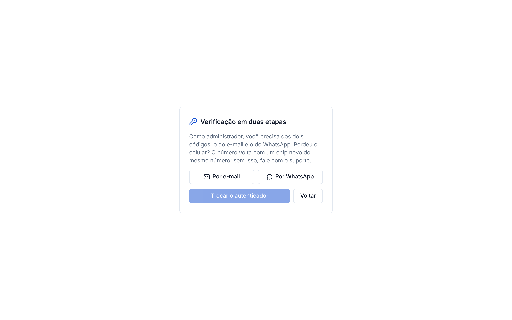
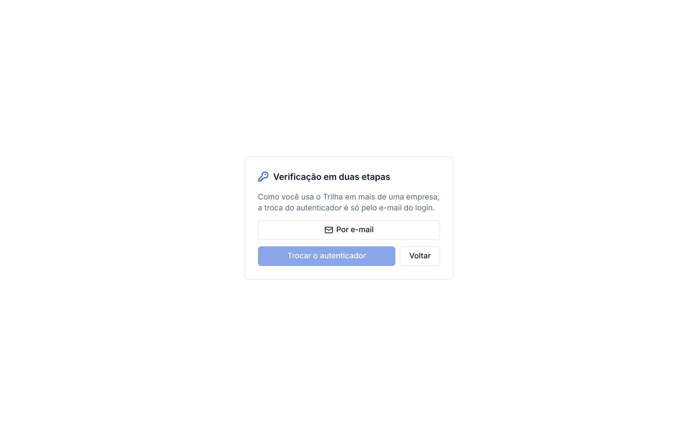
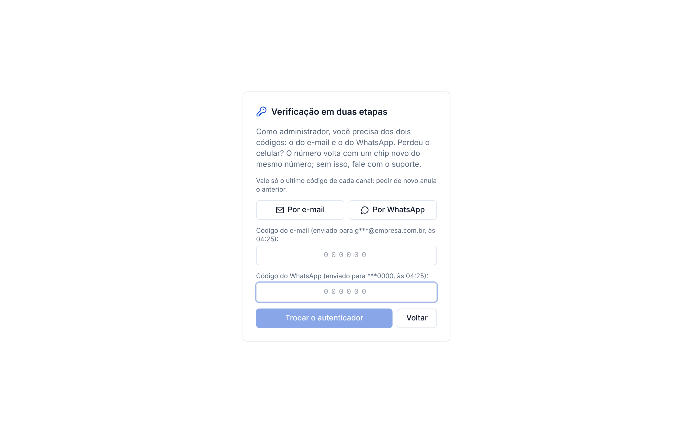
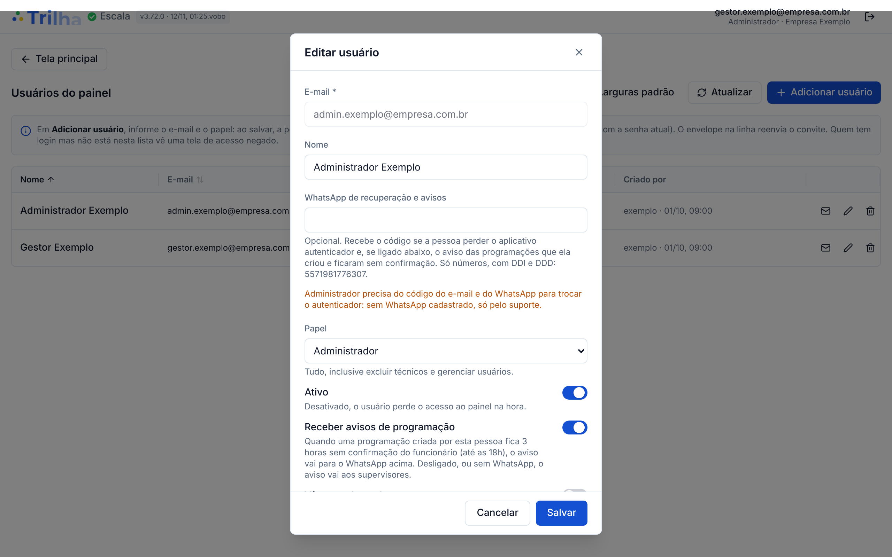

# Procedimento: perdi o aplicativo autenticador

Para quem usa o painel do Trilha (https://trilha.david-cerqueira.workers.dev) e trocou de celular, apagou o aplicativo
autenticador ou não consegue mais gerar o código de 6 dígitos. Vale a partir do painel **3.72.0** (B3, migration 151,
decisão 128 revista em 10/11).

As telas abaixo são do painel 3.72.0 de produção rodando localmente, com dados de exemplo (nenhum dado real).

## 1. Quem recupera de que jeito

| Quem você é | Como troca o autenticador |
|---|---|
| Administrador de qualquer empresa (ou da plataforma) | Código do **e-mail** **e** código do **WhatsApp** |
| Usa o Trilha em **mais de uma empresa** | Só o código do **e-mail** do login |
| Usa o Trilha em uma empresa só | Código do e-mail **ou** do WhatsApp |

O WhatsApp é o "WhatsApp de recuperação e avisos" cadastrado pelo administrador na tela **Usuários**. O do administrador
só vale se estiver cadastrado nas empresas que ele administra.

## 2. Passo a passo

**1. Entre com o e-mail e a senha.** O painel abre a tela do código. Clique em **Perdi meu autenticador**.

**2. Veja quais códigos o painel pede.** A tela explica a sua regra.

Administrador: os dois códigos.

Quem usa o Trilha em mais de uma empresa: só o e-mail.

Uma empresa só: qualquer um dos dois.

**3. Peça o código.** Clique em **Por e-mail** e, se for o seu caso, em **Por WhatsApp**. Cada código chega em poucos
segundos, vale **10 minutos** e só o último pedido de cada canal vale.

**4. Digite os códigos e clique em Trocar o autenticador.** O autenticador antigo sai e o painel pede o cadastro do novo
(QR no aplicativo). Você recebe um e-mail avisando da troca.

**Limites:** 1 pedido por minuto e 6 por dia em cada canal; 5 tentativas por código.

## 3. Mensagens que podem aparecer

| Mensagem | O que fazer |
|---|---|
| "Como você usa o Trilha em mais de uma empresa, a troca do autenticador é só pelo e-mail do login." | Use o botão **Por e-mail** |
| "Administrador precisa também do código pelo WhatsApp..." | Peça a outro administrador da sua empresa para cadastrar o seu WhatsApp em **Usuários**, ou fale com o suporte |
| "Seu WhatsApp de recuperação está diferente entre as empresas que você administra..." | Peça para deixarem o mesmo número nas empresas, ou fale com o suporte |
| "Confirme os códigos do e-mail e do WhatsApp." | Administrador: digite os dois códigos |
| "Código errado ou vencido." | Peça um código novo (o anterior deixa de valer) |
| "Muitos pedidos hoje." | Tente amanhã ou fale com o suporte |

**Perdeu o celular?** O WhatsApp volta com um chip novo do mesmo número (operadora). Sem isso, administrador só
recupera pelo suporte.

## 4. Para o administrador: deixe o WhatsApp cadastrado

Em **Usuários → editar**, todo administrador precisa do **WhatsApp de recuperação e avisos** (só números, com DDI e
DDD). Sem ele, o painel avisa em amarelo e a recuperação só sai pelo suporte. A pessoa recebe e-mail sempre que o número
muda.

## 5. Para o suporte: quando a tela não resolve

Roteiro com conferência de identidade e SQL pronto: `docs/caminhos-de-producao.md`, seção 6. Só o responsável roda, no
SQL Editor da produção.

## 6. Conferência da produção (12/11)

- Aplicar verde (run 43153866012): migration 151 aplicada e registrada pela trava, `plpgsql_check` zero, Edge Function
  `recuperar-duas-etapas` publicada, painel 3.72.0 no Worker `trilha`.
- Painel no ar conferido de fora: `version.json` com o build de 12/11 01:20.
- Telas acima geradas com o build de produção 3.72.0 e o servidor simulado. O teste com login real na produção é do
  responsável (o ambiente do Claude não alcança a produção nem tem login lá).
